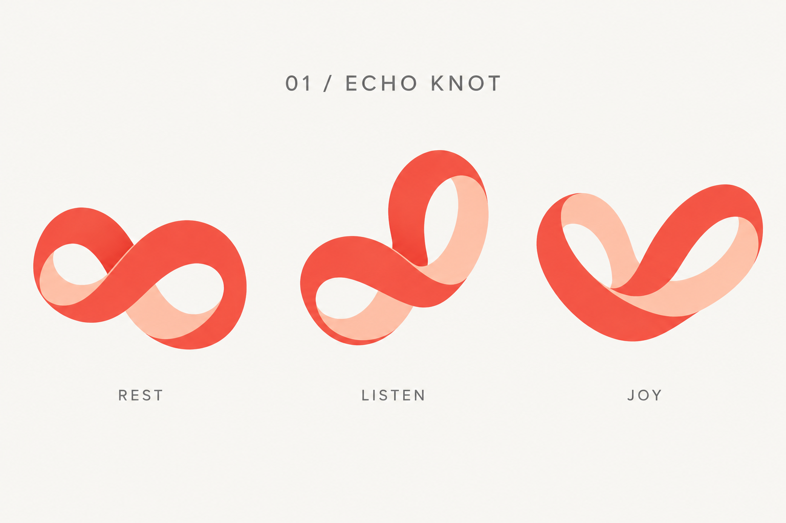
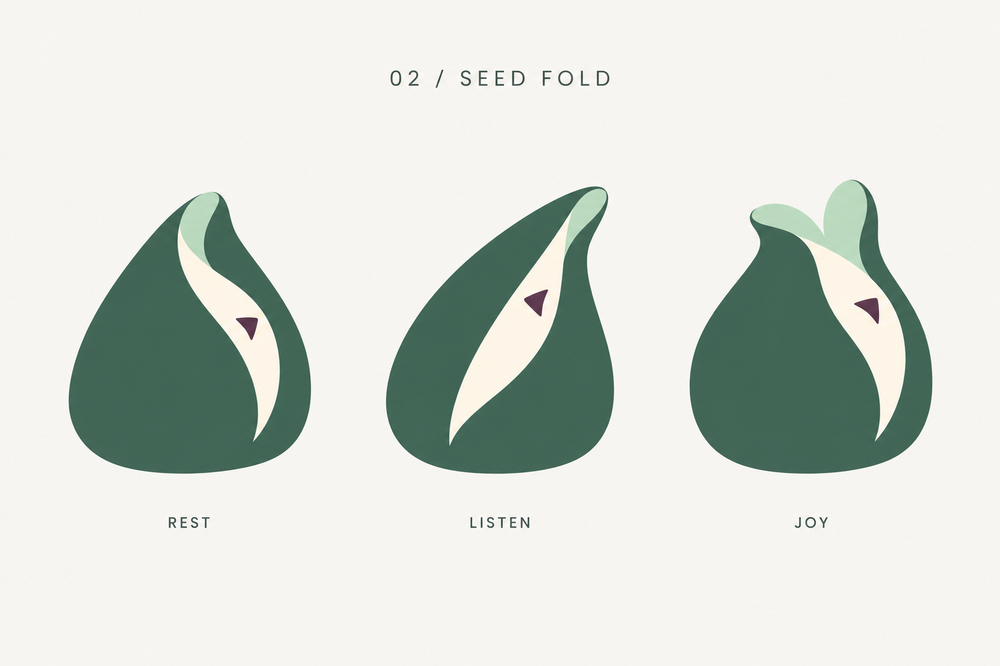
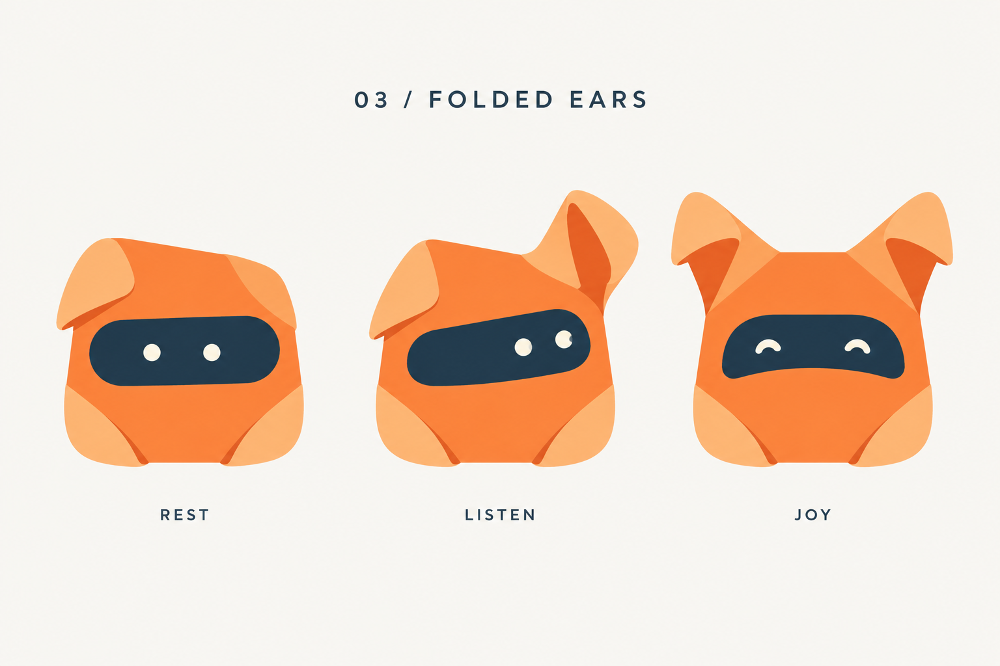
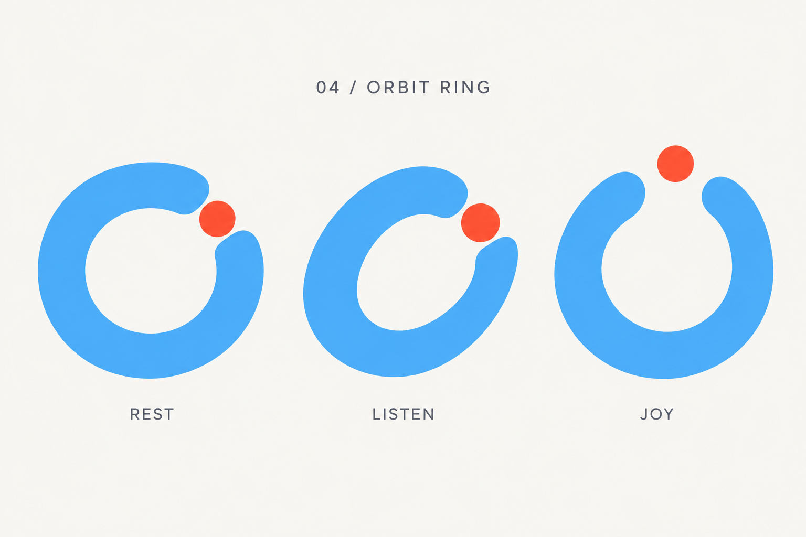
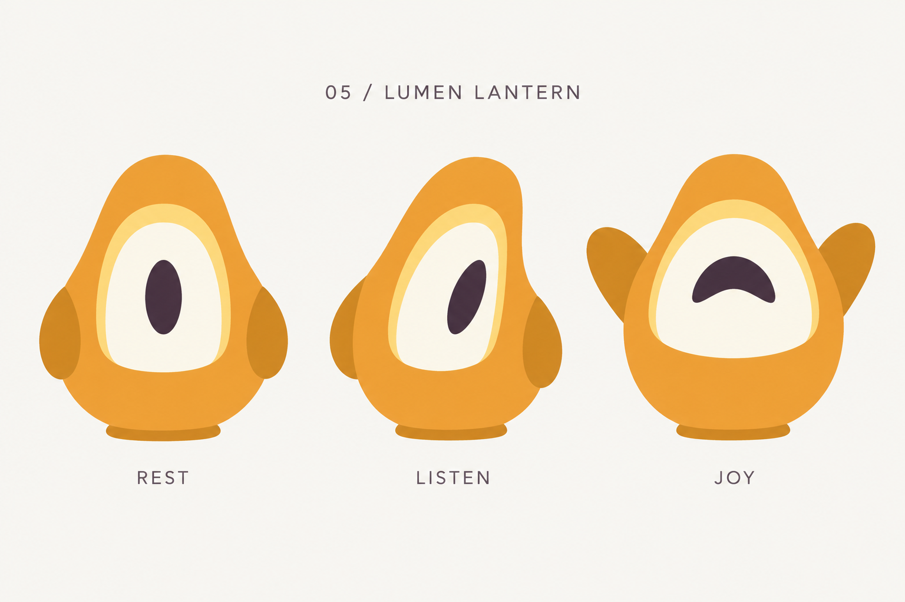
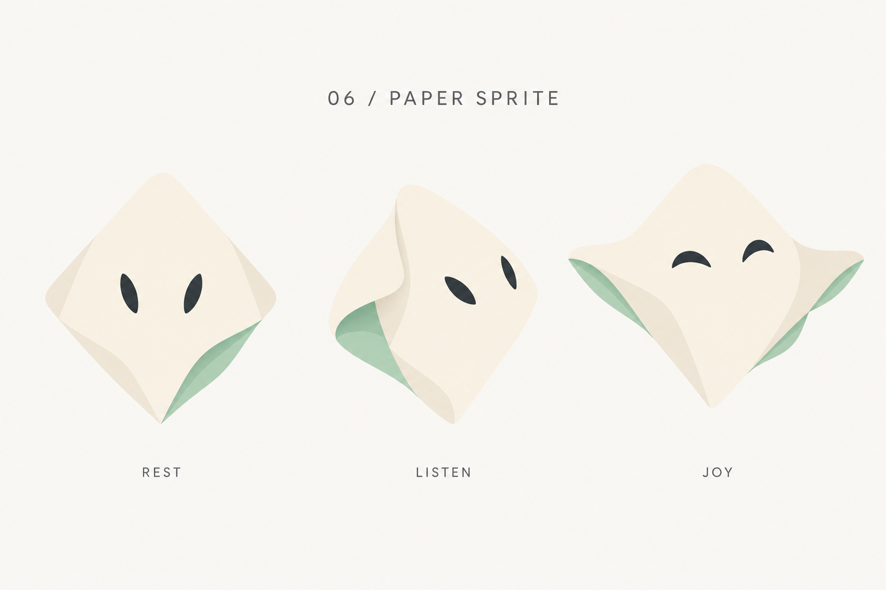
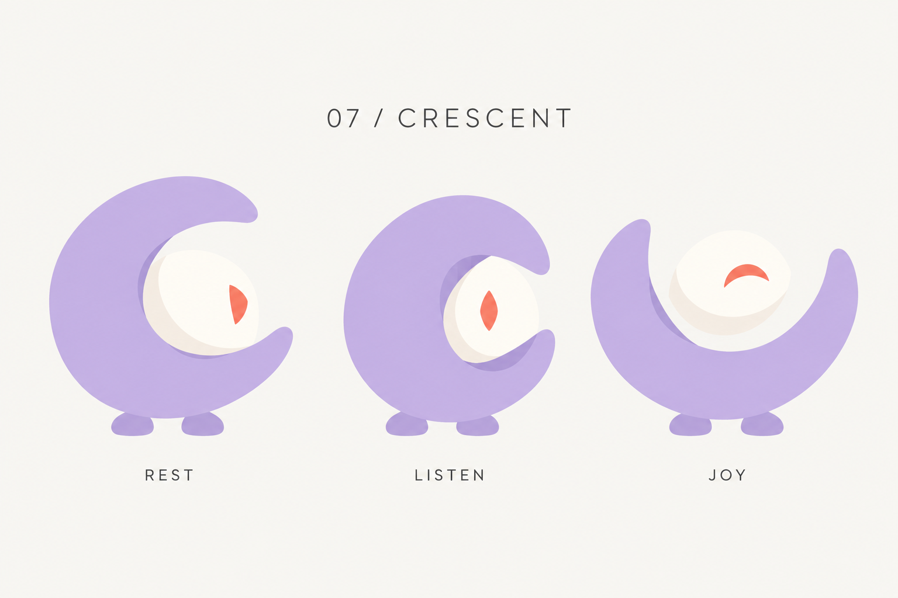
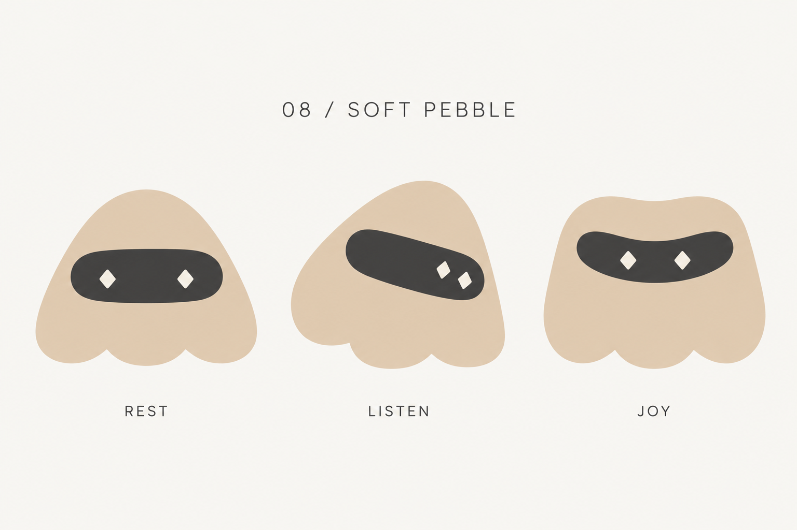
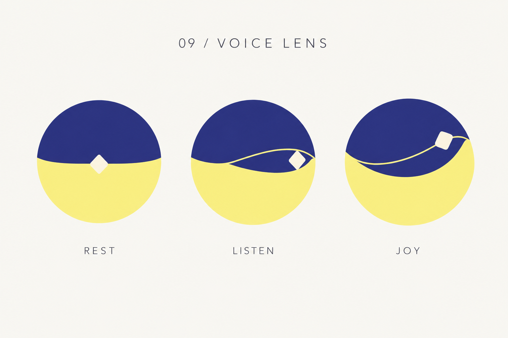
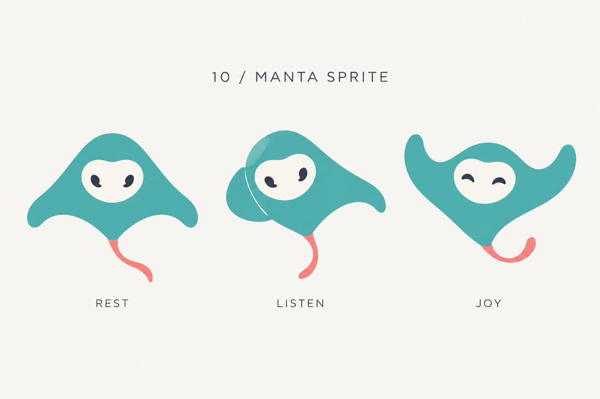

# iTalk independent character systems v3

Date: 2026-10-26
Method: built-in image_gen, ten separate calls. No reference images, competitor source, artwork or previous generated concepts were supplied to these calls. Each image contains three states: REST, LISTEN, JOY. Titles are working concept labels, not cleared brand names.

This is a concept exploration, not a legal clearance or a production asset specification. No iOS source, Claude-owned files or existing app assets were changed.

## Reducing similarity risk

- Start from our voice companion's own behavior and personality rather than a competitor's artwork.
- Change the dominant silhouette, gaze construction, proportions, palette, negative-space signature and motion grammar together. A color swap alone is not the design objective.
- Preserve these prompts, generated files and subsequent human drawing/rig revisions as process records. Records document the process; they do not prove non-infringement.
- Once a short list is chosen, search relevant character artwork, figurative trademarks and registered designs in the intended markets, and have a qualified IP professional assess the final drawing, motion and branding before launch.
- No reverse-image search, trademark or registered-design clearance has been completed for these ten candidates. AI generation does not guarantee freedom from third-party rights or exclusive copyright ownership.

Sources checked on 2026-10-26: [WIPO copyright overview](https://www.wipo.int/en/web/copyright) explains the expression/idea distinction. [USPTO likelihood of confusion](https://www.uspto.gov/trademarks/search/likelihood-confusion) explains U.S. trademark appearance/commercial-impression and related-goods considerations. Specific legal outcomes depend on jurisdiction and facts.

## Concept index and visual review

### 01 回声结

Loop tension provides an expressive non-facial direction. Infinity motifs are common, so this is not the strongest distinctiveness candidate without a thorough search.

### 02 听芽

The seed fold and single aperture move away from the previous face construction. Small-size emotional readability needs testing.

### 03 折耳

Listening fold is readable; a face within a visor supports further expression development. Generic robot/visor conventions still need a differentiated final drawing.

### 04 环灵

Very simple, non-facial state system. Abstract rather than obviously emotional; small-scale identity and existing ring marks need checking.

### 05 灯芯

Expressive single-aperture lantern. Generated side lobes resemble arms; requires deliberate decisions about simplification and character identity.

### 06 纸灵

Paper folds offer a clear silhouette and expressive listening pose. Default eye taper should be softened if it reads as stern.

### 07 月芽

Single-eye crescent can curl and unfold. Generated feet and soft shading are exploratory, not approved production geometry.

### 08 石伴

Rounded pebble with diamond gaze and a visor; readable, but several familiar mascot conventions remain.

### 09 声窗

Preserves a circular body while replacing paired eyes with one aperture. Circle/equatorial motifs are common and should be screened before adoption.

### 10 游灵

Rounded wing silhouette and tail support a clear cupped-listening gesture and buoyant joy. Promising for character animation; not a uniqueness or clearance conclusion.

## Output verification

Inspected all ten generated sheets: each has three poses and its own construction and palette. Some images retain soft fold shading and slight pose-to-pose shape variation; vector redrawing and animation testing remain future work. No claim of measured uniqueness or legal safety is made.

## Shared generation prompt

Use case: stylized-concept. Create an independent original character-system exploration for iTalk, a native voice AI companion.
Output ONE landscape 3:2 professional concept sheet, about 1536x1024, for ONE design family. Show exactly THREE clear iterations of the SAME character across one row: REST, LISTEN, JOY. Equal visual scale and ample margins, each character about 24% of page width. Above them a small tasteful sans-serif title; below each a small label. This is a coherent design system, not three unrelated mascots.
Art direction: polished premium flat 2D vector-like character design with clean soft silhouettes, disciplined negative space, expressive believable personality, enough simplicity to read as a 40px avatar and to animate in SwiftUI. Each pose must feel alive and clearly communicate its state. Use only two or three carefully chosen solid colors per character. Body interiors must stay clean. Plain warm off-white #F7F6F2 page. No 3D materials, render lighting, grain, gradients, visual noise, heavy outlines, shadows, photorealism, UI chrome or watermarks.
Originality constraints: design from this conceptual brief, with no input images and no imitation of any existing AI assistant, brand mascot, commercial character or logo. Do not use a black/color filled circle with two slanted white capsule eyes. No familiar robot heads, googly black pupils on a round blob, stock emoji, or copied branding. The title is a temporary concept label, not a trademark claim.

## Per-concept prompts

### 01 ECHO KNOT

"01 / ECHO KNOT". Exact small state labels: "REST", "LISTEN", "JOY". No other text.
Design family and pose directions:
A living abstract knot made from ONE broad coral-red ribbon making exactly two generous rounded loops crossed once, with a peach-colored underside at the single crossing. Open negative spaces form the identity. Compact rounded-diamond silhouette, never a solid circle. No eyes and no mouth. REST: balanced relaxed knot with one loop slightly smaller. LISTEN: one loop tilts and opens like a listening cup while the other settles. JOY: both loops open upward in an elastic, buoyant gesture. Emotion comes from ribbon tension and loop openness. Keep it simple enough for a 40px avatar, no many-loop flower or familiar corporate knot mark.

### 02 SEED FOLD

"02 / SEED FOLD". Exact small state labels: "REST", "LISTEN", "JOY". No other text.
Design family and pose directions:
An asymmetric jade-green seed-shaped character, broad at the base, gently tapering to a folded tip. One clean ivory crescent aperture runs off-center along its folded seam, with one tiny plum triangular gaze mark inside; this is a SINGLE expressive aperture, not a pair of eyes. A mint underside is visible only at the top fold. No arms, legs, mouth or extra leaves. REST: seed seam softly open. LISTEN: folded tip and aperture incline toward the speaker, aperture lengthens. JOY: tip opens into two short rounded leaflike folds and the aperture broadens warmly. Preserve recognizable seed identity, not a green spherical one-eyed monster.

### 03 FOLDED EARS

"03 / FOLDED EARS". Exact small state labels: "REST", "LISTEN", "JOY". No other text.
Design family and pose directions:
A compact soft orange folded-square creature with four folded corner flaps; two upper flaps serve as distinctive listening folds. Its face is ONE broad dark petrol-blue horizontal visor window containing two very small warm-cream round pupils, not white pill eyes on a solid body. Flat tangerine and apricot surfaces, one simple fold boundary only. REST: one upper corner folded down, pupils calm. LISTEN: one upper flap curls outward as a cupped ear and the pupils shift toward it. JOY: both corner flaps spring up, visor becomes a warm shallow upward arc, pupils turn into tiny happy arcs. No full robot body, gloves, wheels, antennae, or resemblance to a known robot mascot.

### 04 ORBIT RING

"04 / ORBIT RING". Exact small state labels: "REST", "LISTEN", "JOY". No other text.
Design family and pose directions:
An open thick sky-blue torus character, a soft horseshoe ring with a deliberately asymmetric opening in its upper-right edge. One small vermilion bead floats in that opening and acts as the attention point. Body is open negative space, not a filled disk. No conventional face or paired eyes. REST: ring relaxed, bead nestled near the gap. LISTEN: ring subtly leans and gap rotates toward the viewer, bead moves to the near edge in focused attention. JOY: ring opens more generously upward and bead lifts just above the opening. Flat solid colors, a single bead, no glowing orbital trails, no metallic shading, no planetary texture.

### 05 LUMEN LANTERN

"05 / LUMEN LANTERN". Exact small state labels: "REST", "LISTEN", "JOY". No other text.
Design family and pose directions:
A friendly abstract amber lantern spirit with a broad upright pear silhouette and a small tucked-flat base, no flame crown and no fire. One large ivory arched window is inset into the center; within it a single dark aubergine lozenge acts as an expressive aperture, not two eyes. Rounded ochre shoulders and a narrow warm-yellow inner rim distinguish the silhouette. REST: window softly oval and lozenge quiet. LISTEN: window and lozenge narrow and lean attentively to one side, top inclines slightly. JOY: arched window widens into a bright rounded fan and the lozenge curves upward. Uniform solid fills, no gradients, no internal glow effects or complex facial parts.

### 06 PAPER SPRITE

"06 / PAPER SPRITE". Exact small state labels: "REST", "LISTEN", "JOY". No other text.
Design family and pose directions:
An ivory folded-paper sprite with a soft kite/diamond silhouette, rounded upper corners, one gently pointed lower fold and a tiny mint-green folded underside visible at one side. Two small expressive dark-ink ALMOND cutout eyes set on a broad ivory face; these are tapered eye slits rather than pill strokes. The folds give its own identity. REST: balanced diamond, eyes attentive. LISTEN: one lateral fold cups forward and both almond eyes angle toward the speaker. JOY: diamond lifts, lateral folds unfurl, eyes become two small dark curved happy slits. No hands, nose or permanent smile mouth; no box robot, no envelope icon printed on it, no thick outline.

### 07 CRESCENT

"07 / CRESCENT". Exact small state labels: "REST", "LISTEN", "JOY". No other text.
Design family and pose directions:
A pale-lilac crescent-shaped companion that gently wraps around one warm-white almond-shaped pearl suspended inside its open side. The pearl has a single small coral triangular pupil, providing a SINGLE eye system. The crescent is the character body, not a solid circle, and has softly rounded tips with no sharp moon points. REST: crescent supports the pearl in a calm forward gaze. LISTEN: crescent curls inward slightly like a listening shell, pearl turns toward the viewer. JOY: crescent opens upward and pearl eye softens into a curved slit. Flat lilac, ivory and coral; no stars, sleeping cap, decorative sparkles, planet rings or metallic materials.

### 08 SOFT PEBBLE

"08 / SOFT PEBBLE". Exact small state labels: "REST", "LISTEN", "JOY". No other text.
Design family and pose directions:
A warm-sand colored rounded triangular pebble character, subtly asymmetric with a broad smooth top and three tiny integrated stepped lobes at its base. Its face is one charcoal curved horizontal inset band, holding two small ivory DIAMOND-shaped pupils, wide apart. Silhouette and diamond gaze system must be instantly different from a round body with two white capsule eyes. REST: compact balanced pebble and calm diamonds. LISTEN: body subtly tilts, one corner rises, diamond pupils shift together in attention. JOY: upper corners lift slightly, band curves upward, pupils become tiny diamonds tilted inward. Premium flat graphic treatment, not a realistic rock, no stone grain, limbs or facial smile line.

### 09 VOICE LENS

"09 / VOICE LENS". Exact small state labels: "REST", "LISTEN", "JOY". No other text.
Design family and pose directions:
A clean circular voice entity whose distinctive design is a single horizontal lens aperture rather than a face. Circle has exactly TWO large flat color regions: deep indigo upper hemisphere and pale citron lower hemisphere. At their boundary is one small warm-white rounded diamond lozenge as an attention cursor, never paired eyes. REST: thin quiet lens seam and centered lozenge. LISTEN: the seam opens into a narrow asymmetric almond-shaped window facing the speaker, lozenge shifts toward its opening. JOY: the two halves open a little into a generous crescent window while maintaining an overall rounded silhouette, lozenge lifts playfully. Extremely clean flat fields, no gradients, waves, particles, noisy interior, glass shell, or existing assistant orb appearance.

### 10 MANTA SPRITE

"10 / MANTA SPRITE". Exact small state labels: "REST", "LISTEN", "JOY". No other text.
Design family and pose directions:
A tiny abstract teal manta-like companion with a soft wide kite silhouette, two rounded wing tips and a short slender coral curved tail. A small off-white mask-shaped face panel contains two small dark comma-shaped eyes, different from floating white capsule strokes. Keep this a graphic abstract floating spirit, not a realistic animal. REST: rounded wings relaxed, gaze forward. LISTEN: one wing tip gently curls toward its face like a listening cup, eyes focus toward the viewer. JOY: both wing tips lift and tail makes a small buoyant upward curve, eyes arc happily. No arms, gloves, ears, belly spots, fins texture, teeth, permanent smile or imitation of a known bird/animal mascot.

