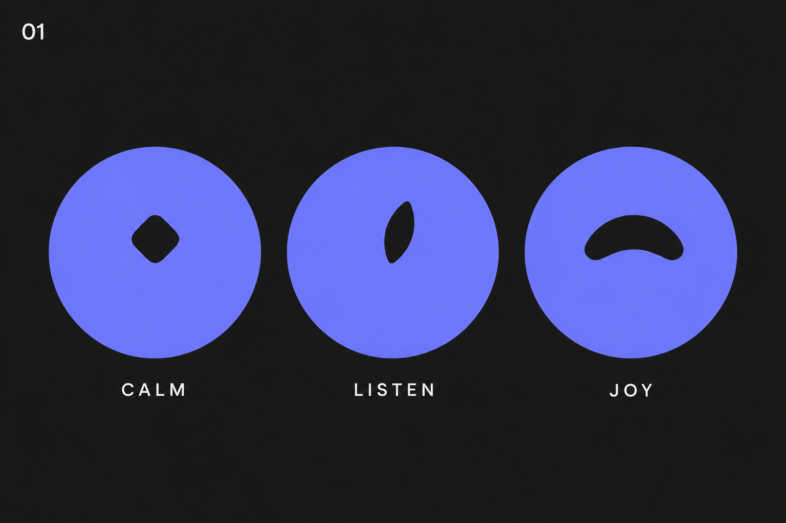
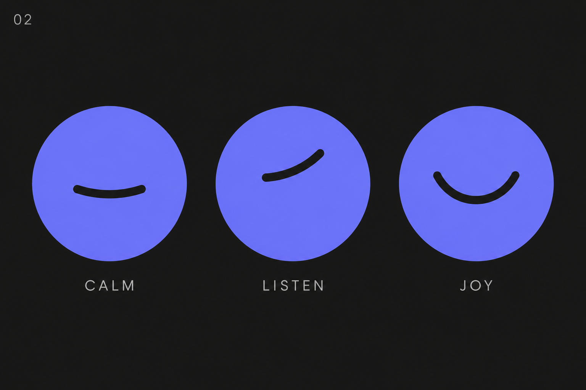
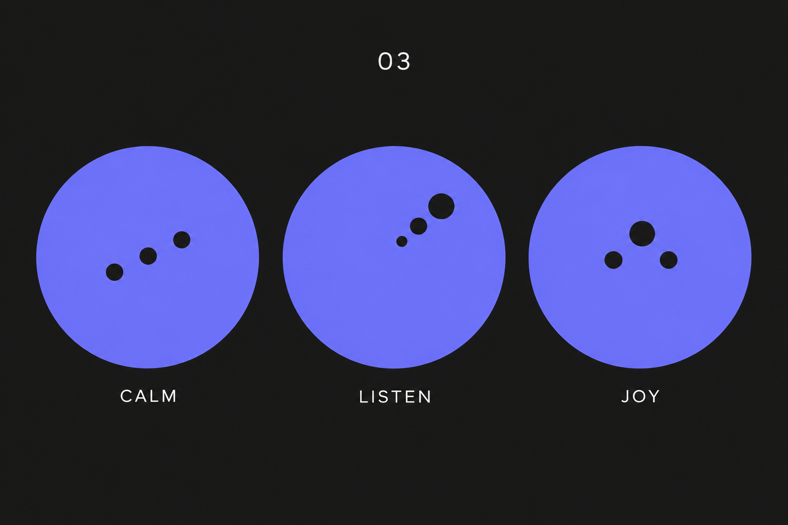
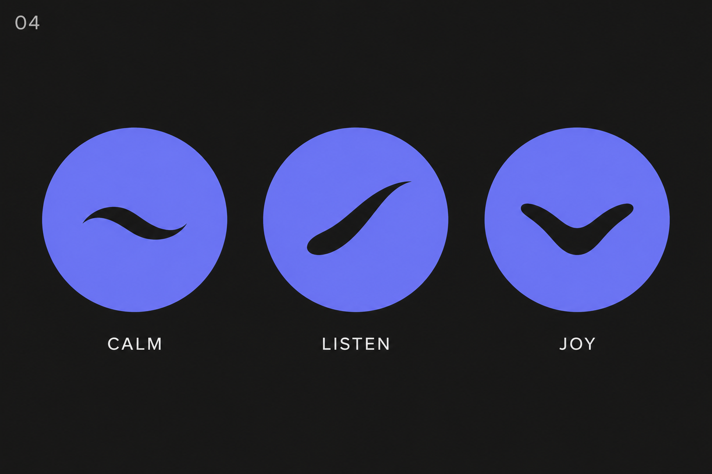
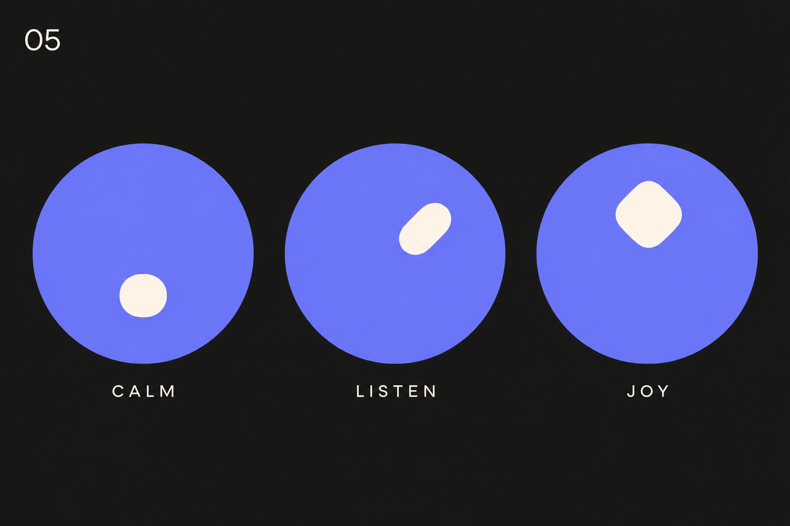
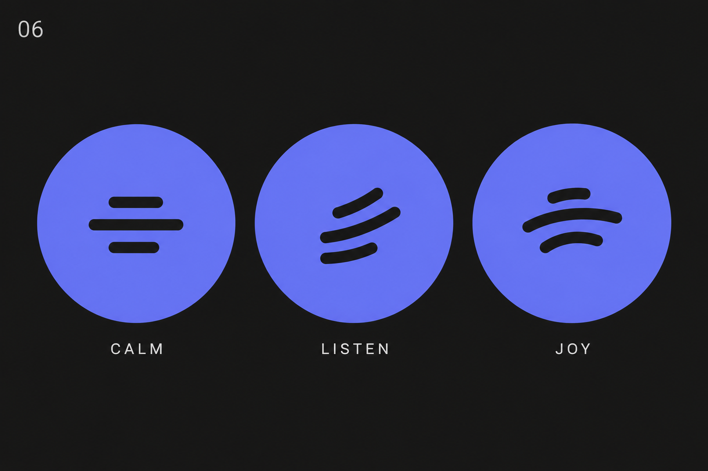

# iTalk internal expression mechanisms v5

Date: 2026-10-26
Method: built-in image_gen, six separate calls, no reference image input. Static exploration only; no app code or Claude-owned files changed. All sheets use the same circular body and palette to compare how internal marks can carry expression without a conventional pair of eyes.

Each sheet reads left-to-right: CALM, LISTEN, JOY. These are intended states, not user-tested emotional interpretations. Animation behavior is a design hypothesis, not an implemented or verified motion result.

## Concepts and review

### 01 呼吸孔

Aperture opening is expressive, but the proposed joy shape can be read as a closed eye or frown; do not assume its emotional meaning is clear.

### 02 情绪弧线

Single-curve gesture has the clearest static emotional reading in this batch. It may read as a mouth; that is acceptable as an alternative to paired eyes, not proof of a non-facial interpretation.

### 03 三点节奏

Dot arrangement communicates state/rhythm more readily than emotion. Needs a motion prototype and should not be treated as a proven character expression.

### 04 负形开合

Negative-space cut is visually clean and gestural, but a short animation is needed to assess whether it reads as personality rather than a graphic symbol.

### 05 偏心色块

Moving single core is a possible non-facial attention system. Static shape alone is not enough to establish emotional legibility.

### 06 短线姿态

Stacked/curved strokes risk reading as an audio/menu brand or function icon. Do not prioritize this candidate without further differentiation and similarity screening.

## Shared prompt

Use case: stylized-concept. Create a new minimalist non-facial expression-system study for an iTalk voice companion.
Output ONE landscape 3:2 concept sheet, 1536x1024. Exactly three instances of the SAME simple character in a row, with labels CALM, LISTEN, JOY. No other characters or UI.
Every instance has the same perfectly circular uninterrupted outer silhouette, the same size, same single completely uniform periwinkle-blue fill #7275F5. Body diameter about 24% of page width. All expressive marks remain fully INSIDE that one circle. Plain dark charcoal #191919 page. This study compares INTERNAL expression mechanisms, not different body shapes or colors. Do not change background or body color across states.
Graphic style: extremely clean crisp flat vector-like geometry, solid fills, only two or three colors total. Premium restrained digital personality. The marks are small and deliberate, with abundant clean empty space. Readable at a 40px avatar size.
We are deliberately exploring expression WITHOUT conventional faces. No pair of eyes, eyebrows, nose, mouth, iris, pupils, human facial anatomy or familiar emoji face. No limbs, hands, ears, tails, visor, masks, shells, nested bodies, accessories, internal wave textures, glow, gradients, 3D lighting, shadows, outlines, grain, sparkles, particles, logos or watermarks. Do not imitate an existing AI mascot.
Give each state a subtly expressive, intentional gesture. Do not add extra components to make it emotional. Static images should suggest a living motion language.

## Per-concept prompts

### 01 呼吸孔

"01". Exact state labels: "CALM", "LISTEN", "JOY". No other text.
Internal expression mechanism:
ONE single charcoal aperture is the entire expression, not two eyes and not a face. A small breathing opening with rounded organic geometry, centered slightly above the middle. CALM: a compact rounded diamond with a quiet gently open center. LISTEN: the one opening stretches into a narrow upright almond and leans slightly toward the speaker. JOY: it opens into a broad soft arch-shaped aperture with round corners, as if a delighted breath. No iris, no pupil, no outline around the aperture. Make these three clearly related but expressively different.

### 02 情绪弧线

"02". Exact state labels: "CALM", "LISTEN", "JOY". No other text.
Internal expression mechanism:
ONE continuous short charcoal curve is the entire expression. It is a gestural mark, not one of a pair of eyes and not part of a face. Use a rounded-end stroke, about 24% of the body diameter wide. CALM: a shallow almost horizontal soft curve, tranquil. LISTEN: the single arc inclines upward toward one side, slightly tighter and shifted upward, as if leaning in attentively. JOY: the same stroke opens into a generous upward-facing U/crescent gesture, buoyant and warm. No other facial elements. The one line's tension, angle and curvature convey emotion.

### 03 三点节奏

"03". Exact state labels: "CALM", "LISTEN", "JOY". No other text.
Internal expression mechanism:
Exactly THREE small charcoal solid dots act together as a rhythmic emotional gesture, never two eyes with a mouth. Keep them clearly arranged as a single compact three-dot cluster. CALM: three equal small dots along a shallow rising diagonal, balanced and quiet. LISTEN: the three dots gather closely toward the upper-right interior, varying subtly in size, communicating concentrated attention. JOY: the middle dot lifts above the two outer dots and the cluster opens into a playful upward triangular bounce. Not an ellipsis loading screen: make the cluster feel like a small living gesture.

### 04 负形开合

"04". Exact state labels: "CALM", "LISTEN", "JOY". No other text.
Internal expression mechanism:
A SINGLE clean charcoal negative-space ribbon cutout INSIDE the colored circle carries the emotion. It is an abstract folded gap, NOT an eye, not a mouth, not a stripe across the whole body. All cutout edges remain at least 18% of the diameter away from the outer boundary, so the circular silhouette remains uninterrupted. CALM: a small flowing S-like sliver with rounded tapered ends. LISTEN: the sliver lengthens and leans toward one side, creating an asymmetric alert opening. JOY: the gap opens into a wider, buoyant, rounded chevron/butterfly-fold negative space. Use one compact dark shape only; no texture, panels, seams or multiple layers.

### 05 偏心色块

"05". Exact state labels: "CALM", "LISTEN", "JOY". No other text.
Internal expression mechanism:
ONE small warm-ivory solid core inside the blue circle is the entire expressive system. No face and no dark eyes. Core occupies about 12% of body diameter. Personality comes from the core's balance, offset, and geometric deformation. CALM: a small gently rounded core centered slightly low, settled. LISTEN: the core moves up and to the right and becomes an inclined rounded lozenge, alert and attentive. JOY: core lifts toward the upper middle, slightly larger and becomes a plump rounded four-corner diamond, springing upward. Show a believable related motif, not an iris within an eyeball and not a billiard ball marking.

### 06 短线姿态

"06". Exact state labels: "CALM", "LISTEN", "JOY". No other text.
Internal expression mechanism:
Exactly THREE small charcoal rounded-end line strokes make ONE compact expressive gesture in the center of the circle. They are not paired eye marks. No circle/dot eye components and no mouth. CALM: three short soft horizontal strokes stacked with unequal lengths in a balanced compact cluster. LISTEN: the three strokes incline together toward one side and gently curl at their ends, suggesting attentive leaning. JOY: the same three strokes fan upward in a compact buoyant gesture, like the character briefly stretching within itself. Keep all strokes inside the circle, no external rays or surrounding effects. Make it restrained, characterful, not a menu icon, signal bars or an audio equalizer UI.

All six generated sheets were visually inspected. Some intended flat fills retain subtle raster shading; a chosen concept should be redrawn as clean native geometry. No intellectual-property clearance is claimed.

