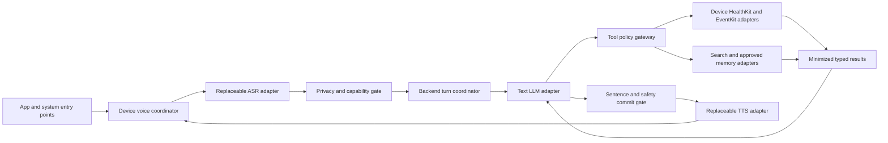

# iTalk: native voice assistant research and technical design

Research date: 2026-10-25, Asia/Shanghai. Status: original research snapshot; development authorized in the subsequent conversation on 2026-10-25. See README.md for current implementation and verification status.

This document answers the 14 research deliverables in the supplied specification. It contains no implementation. V1 serves spoken Mandarin Chinese on iPhone and Apple Watch. It is a voice assistant with optional health capabilities, not a text-chat product, system assistant replacement, or health dashboard.

Evidence labels used throughout:

- **Verified:** established by a cited platform/provider document or inspected SDK declaration. This does not mean tested in this app.
- **Proposed:** an engineering or product decision to validate after development approval.
- **Unverified:** requires an account, entitlement, target SDK, physical device, benchmark, or distribution decision that was not available in this research.

## Recommendation and release boundaries

**Proposed:** proceed with a native SwiftUI iOS 26/watchOS 26 design, a strict half-duplex audio coordinator, local iPhone ASR where supported, local TTS by default, and a small backend with replaceable model adapters. Keep health calculations and raw HealthKit records on the device. Introduce cloud health reasoning only under a separate, explicit consent grant.

Five constraints materially shape the product:

1. **Verified:** SpeechAnalyzer and SpeechTranscriber are unavailable on watchOS. The Watch requires a separate speech path. Apple's WWDC session and the installed Speech SDK declarations agree. [Apple speech session](https://developer.apple.com/videos/play/wwdc2025/277/)
2. **Verified:** a Lock Screen control can launch an app, but that does not establish permission to begin arbitrary recording while locked. V1 launches the foreground voice experience and follows system authentication. [Apple controls](https://developer.apple.com/documentation/widgetkit/creating-controls-to-perform-actions-across-the-system)
3. **Verified:** watchOS treats URLSessionWebSocketTask as restricted low-level networking. Direct HTTPS is the conservative independent-Watch transport; simulator success is insufficient. [Apple TN3135](https://developer.apple.com/documentation/technotes/tn3135-low-level-networking-on-watchos)
4. **Verified:** HealthKit read denial cannot generally be distinguished from missing data, and locked health data can be inaccessible. Avoid inventing a reliable per-type read-authorization status. [HealthKit authorization](https://developer.apple.com/documentation/healthkit/hkauthorizationstatus), [locked data](https://developer.apple.com/documentation/healthkit/hkerror/errordatabaseinaccessible)
5. **Verified:** current OpenAI speech documentation includes near-term retirements. Do not start a new production integration around legacy speech endpoints. The migration is not always a model-name substitution. [OpenAI deprecations](https://developers.openai.com/api/docs/deprecations), [TTS migration notice](https://developers.openai.com/api/docs/guides/text-to-speech)

**Unverified:** launch market, developer-account capabilities, physical device inventory, chosen provider accounts/regions, and real latency/energy. Mandarin support does not imply Mainland China service availability. The provider profile must match the launch market and data-processing consent.

## 1. Apple API, SDK, and entitlement feasibility

### Platform feasibility

| Area | Verified basis | Proposed V1 use and limits |
| --- | --- | --- |
| Native interface | SwiftUI system components adopt the platform appearance; Liquid Glass belongs mainly to controls/navigation | Native navigation, sheets, forms, and one voice home. No custom glass renderer. [Materials](https://developer.apple.com/design/human-interface-guidelines/materials) |
| iPhone ASR | SpeechAnalyzer, SpeechTranscriber, progressive results, AssetInventory introduced with iOS 26 | Check hardware availability, equivalent Mandarin locale, installed assets, and analysis format. Never assume every iOS 26 phone supports the same transcriber. [Speech](https://developer.apple.com/videos/play/wwdc2025/277/), [assets](https://developer.apple.com/documentation/speech/assetinventory) |
| ASR fallback | Apple's DictationTranscriber provides a different supported device/language envelope | Probe it on iPhone when the primary transcriber is unavailable. Legacy SFSpeechRecognizer is a last compatibility adapter with explicit on-device checks; never silently switch to server recognition. [Apple speech session](https://developer.apple.com/videos/play/wwdc2025/277/) |
| Watch speech | New Speech APIs are marked unavailable on watchOS; recording APIs exist | Native foreground audio capture plus consented backend ASR; system dictation as an explicit alternative. No claim of general offline Watch ASR. [Watch recording](https://developer.apple.com/documentation/watchkit/audio-recording-options) |
| TTS | AVSpeechSynthesizer accepts text and selectable voices; Watch SDK exposes it | Select an installed Mandarin voice at runtime; speak sentence-sized committed text. Validate offline operation, voice quality, and Watch speaker routing. [Apple TTS](https://developer.apple.com/documentation/avfaudio/avspeechsynthesizer) |
| Shortcuts/Siri | App Intents and App Shortcuts expose app actions | A single foreground start-voice intent, reused by official entry points. Use iOS 26 supportedModes rather than deprecated foreground-continuation patterns. [App Intents](https://developer.apple.com/documentation/appintents) |
| Controls | WidgetKit controls can perform actions or open an app | OpenIntent with correct target membership for app and control extension. Recording happens in the app. [Controls](https://developer.apple.com/documentation/widgetkit/creating-controls-to-perform-actions-across-the-system) |
| Audio-recording intent | AudioRecordingIntent represents actual recording actions; current docs require a Live Activity while recording under that protocol | Do not adopt it merely to open the app. A later recording-specific intent must implement the documented indicator/Live Activity lifecycle and prove iOS 26/Watch behavior. [AudioRecordingIntent](https://developer.apple.com/documentation/appintents/audiorecordingintent) |
| Watch complications | WidgetKit provides the three requested accessory families | Launch-only content with widgetURL; no microphone capture in a complication extension. [Widget families](https://developer.apple.com/documentation/widgetkit/widgetfamily/accessoryrectangular), [linking/interactivity](https://developer.apple.com/documentation/widgetkit/adding-interactivity-to-widgets-and-live-activities) |
| Health | HealthKit supports granular access on iOS/watchOS; availability and supported types vary | Read-only V1 queries, summaries, and trends; no clinical records entitlement or HealthKit writes. Watch queries its own store; phone availability is an enhancement. [HealthKit setup](https://developer.apple.com/documentation/healthkit/setting-up-healthkit) |
| Calendar/reminders | EventKit has write-only events, full-access events, and full-access reminders | OS permissions are broader than app tool grants: enforce app read-only scopes independently. EventKit has no read-only OS access mode. [Event store](https://developer.apple.com/documentation/eventkit/accessing-the-event-store) |
| Maintenance | BGProcessingTask is system scheduled and interruptible | Opportunistic local consolidation plus next-launch catch-up. Authorized backend scheduling handles already-approved cloud material. [Background tasks](https://developer.apple.com/documentation/backgroundtasks/bgprocessingtask) |
| Notifications | UserNotifications supports permissioned notifications | Ordinary wellness/reminder notifications only; no critical-alert entitlement, exact-delivery promise, or medical monitoring claim. [Notifications](https://developer.apple.com/documentation/usernotifications) |

### Signing and configuration inventory

All items below are proposed configuration requirements, not claims that signing has succeeded.

| Target/capability | Configuration | Scope |
| --- | --- | --- |
| iPhone and Watch microphone | NSMicrophoneUsageDescription; appropriate runtime authorization | Explain when recording starts; no ambient listening |
| Optional legacy speech adapter | NSSpeechRecognitionUsageDescription and speech authorization where required | Include only if that API path ships; not evidence that every SpeechAnalyzer path requires it |
| iPhone and Watch HealthKit | HealthKit capability/com.apple.developer.healthkit; NSHealthShareUsageDescription | Read selected types only; no update-purpose string unless writes are introduced |
| Optional health observer delivery | HealthKit background-delivery entitlement and supported observer setup | Freshness optimization only; not a guaranteed schedule or locked-store bypass |
| iPhone and Watch calendar/reminders | NSCalendarsFullAccessUsageDescription, optionally NSCalendarsWriteOnlyAccessUsageDescription, NSRemindersFullAccessUsageDescription | Just-in-time requests on the executing target; select the least OS access necessary for each feature |
| iPhone widget/control and Watch widget extensions | Correct bundle relationships; App Groups only where an app and its extension share nonsensitive state | An App Group does not share a filesystem across iPhone and Watch |
| Optional iPhone maintenance | BGTaskSchedulerPermittedIdentifiers and processing background mode | Expiration handling; no background audio merely to keep a process alive |
| Optional server push | Push Notifications capability/aps-environment; explicit notification permission | Omit if V1 uses only local notifications |
| Optional recording Live Activity | NSSupportsLiveActivities and ActivityKit/WidgetKit configuration as applicable | A recording lifecycle feature, not an entitlement to indefinite microphone access |
| Transport and credentials | ATS-compliant HTTPS, Keychain device/session credentials | No provider secret embedded in app or extensions |

**Verified locally:** workspace had no project source or commits. Installed toolchain is Xcode 27.0, build 27A266a. Inspected the iPhoneOS SDK Speech and AppIntents Swift interfaces, HealthKit HKHealthStore header, and WatchOS AVFAudio headers without building or running project code.

**SDK drift warning:** the installed SDK is newer than the requested SDK. Its HealthKit earliest-authorized-sample-date API is marked iOS/watchOS 27.0 and must not appear in an iOS 26 baseline implementation. Live web documents may also describe newer APIs. Verify every adopted symbol against an actual Xcode 26 SDK after approval; use newer APIs only behind availability gates if a newer build SDK is separately accepted.

**Release gate:** verify provisioning for both app targets and extensions, baseline SDK availability, supported physical devices, actual HealthKit purpose disclosures, and App Review suitability. A general assistant must clearly explain the health/fitness purpose of its optional HealthKit feature. Platform documentation is not an App Review approval. [Health privacy](https://developer.apple.com/documentation/healthkit/protecting-user-privacy)

## 2. Activation matrix

All successful activations enter one idempotent route: request a new foreground voice session, authenticate if required, check permissions/assets, show recording state, then activate capture. First use includes onboarding; immediate listening is only promised after setup. Returning from Settings, task switching, or a notification does not itself restart the microphone.

**Proposed privacy boundary:** auto-listen on an explicit cold app launch or a validated start-voice intent/deep link. A generic warm foreground transition does not reliably identify the person's intent to record. If the system delivers no distinguishable launch action, show the single continue/listen control. Unconditional auto-listening on every warm app-icon return would require accepting the same behavior for indistinguishable foreground returns; that trade-off needs an explicit product decision rather than an invented launch-detection guarantee.

| Entry point | Device/capability | Setup | Unlocked behavior | Locked/background behavior | Evidence and acceptance |
| --- | --- | --- | --- | --- | --- |
| App icon | Supported iPhone | Microphone and ASR setup | Explicit new launch enters listening when ready | System launch/unlock rules apply | Physical cold/warm launches and denied permissions |
| iPhone Action Button | Models with a configurable Action Button | User assigns the official app Shortcut in Settings | Runs foreground voice intent | Authentication may add interaction; no lock bypass | [Hardware interactions](https://developer.apple.com/documentation/appintents/hardware-interactions); test on an actual Action Button phone |
| App Shortcut | iPhone Shortcuts | App publishes start-voice action | Opens voice route | System may require unlock/foreground | Run manually and through an automation; no autonomous ambient capture |
| Siri phrase | Siri configured for Mandarin and app shortcut discoverable | User enables Siri/app access | Siri hands off to the voice app | System decides availability/authentication; handoff audio must release before app capture | Siri listening and app listening must never overlap |
| Control Center control | Supported iOS 26 iPhone | User adds control | ControlWidgetButton opens voice route | Control Center access depends on system settings; app may require unlock | [Controls](https://developer.apple.com/documentation/widgetkit/creating-controls-to-perform-actions-across-the-system); verify control/app target membership |
| Lock Screen control | Supported iOS 26 iPhone | User adds control | Opens app | V1 requires system unlock before recording and before sensitive display | Cannot repurpose camera-only locked capture privileges |
| Watch app | Supported watchOS 26 Watch | Independent sign-in/session and permissions | Foreground capture via Watch ASR adapter | Cancel capture on loss of active recording context; wrist-down behavior needs physical proof | Test with phone unavailable |
| Three complications | Faces with each requested slot | User installs complication | widgetURL opens voice route | System Watch lock requires unlock; no recording in widget | Tap each family on actual supported faces |
| Smart Stack | Watch supports accessoryRectangular | User adds/pins widget; OS controls prominence | Opens same voice route | No guaranteed promotion, reload rate, or persistent recording | [Rectangular family](https://developer.apple.com/documentation/widgetkit/widgetfamily/accessoryrectangular) |
| Watch Shortcut/Siri | Action available in Watch Shortcuts | Publish Watch-compatible intent; Siri setup | Opens Watch foreground voice route | Prompts/handoff depend on OS; test separately from iPhone intent | No exclusive dependence on phone execution |
| Watch Ultra Action Button | Ultra supports Shortcut action | User chooses Shortcut then the assistant launch action | Shortcut opens voice app | Lock and foreground constraints remain | [Ultra button](https://developer.apple.com/documentation/appintents/actionbuttonarticle); verify shortcut actually appears/runs on Watch |

**Verified boundary:** direct third-party Watch Ultra Action Button registration is documented for workouts/dives. Use the system Shortcut mechanism for this assistant. Do not masquerade as a workout/dive app. No mouse, external hardware button, legacy mute-switch interception, always-on wake word, or general hardware remapping is included.

## 3. Apple Watch complication and companion specifications

**Proposed designs:** WidgetKit owns shape, margins, type scaling, and tinting; do not impose fixed pixel geometry or glass backgrounds inside watch-face slots. All variants target a validated launch route such as `italk://voice/start?source=complication`, whose only effect is opening the app. Deep links convey no permissions, private text, account token, or executable tool arguments.

| Family | Content | Interaction/accessibility | Rendering and privacy |
| --- | --- | --- | --- |
| accessoryCircular | Single SF Symbols microphone centered in the native family container | Entire complication launches; VoiceOver: "Open iTalk voice assistant" in Mandarin | Template/tinted symbol; no fake progress ring, waveform, health score, or decorative background |
| accessoryCorner | Microphone primary view; optional short native widgetLabel if supported by the chosen face | Same route; never make the bezel label a separate target | Respect corner/curved label layout; omit label when it harms legibility. [widgetLabel](https://developer.apple.com/documentation/swiftui/view/widgetlabel(label:)) |
| accessoryRectangular | First line: app name plus microphone. Second line: "Tap to speak" in Mandarin | Single launch target; Smart Stack uses the same intent | Default to static launch copy. An optional status must have timestamp/expiry and show setup required when stale; never show transcript or health information |

Support applicable widgetRenderingMode values, tinted/accented appearances, Always On dimming, and system redaction. Do not require a specific accent to distinguish readiness. Timeline refreshes are budgeted by the OS, so complications cannot truthfully represent a continuously live microphone or backend connection. [Widget appearance](https://developer.apple.com/documentation/widgetkit/preparing-widgets-for-additional-contexts-and-appearances)

Watch app hierarchy: one voice screen with status, brief transcript/answer, and one context-changing record/stop control. A secondary menu opens history, permissions, and connection status. Permit scrolling for long answers and large text; use native sheets for confirmations. No health dashboard or unnecessary tabs.

**Proposed standalone transport:** Watch authenticates directly to the service using its own revocable device credential. Use high-level HTTPS requests for session creation, sequential audio chunks, transcript/result events, tool jobs, and cancel. Backend adapters own provider WebSocket/gRPC connections. Try incremental HTTP response delivery or a cursor-based short poll while the app is active; neither path assumes Watch low-level socket permission. Polling/chunk sizes are performance experiments, not documented latency guarantees.

**Unverified spike:** foreground audio capture + 250-500 ms HTTPS chunks + incremental Mandarin transcript on a physical GPS Watch using Wi-Fi and cellular Ultra. If that misses energy/network gates, use a bounded recording upload with visible processing as a disclosed degraded mode; do not claim the streaming Watch requirement passed. System dictation is an explicit accessibility/fallback choice and may add system UI or server processing. Full V1 acceptance still requires the chosen incremental path where the selected provider supports it.

WatchConnectivity may accelerate setup or provide a phone snapshot, but no launch, authentication renewal, backend turn, or cancellation may require a reachable phone. Health availability is local-store-specific; do not claim that Watch and phone contain identical or fully synchronized records.

## 4. UI tokens, navigation, and Mandarin behavior

**Home's job:** let a person speak one request, understand the current listening/working/speaking state, and hear a short grounded answer.

**Proposed native composition:** one NavigationStack; a short heterogeneous ScrollView for status, live transcript, and answer; native toolbar actions for history/settings; a safeAreaInset for the main voice button. Settings use Form/List and native navigation destinations. Memory review is a searchable List with details and a system edit sheet. Destructive operations use confirmation dialogs; external writes use a review sheet.

| Token | Mapping | Rule |
| --- | --- | --- |
| Background/base | systemBackground or systemGroupedBackground by container | Semantic adaptation in light/dark; no fixed white/black |
| Background/content | secondarySystemBackground or secondarySystemGroupedBackground | Two-tone hierarchy for answer/history regions; no glass content cards |
| Text/main | primary + body | Transcript and concise answer wrap; no fixed-height text containers |
| Text/status | secondary + subheadline | State is also expressed in words and accessibility value |
| Text/section | headline | Sparse section labels; standard navigation title |
| Text/provenance | secondary + caption | Timestamp, source, freshness, cloud-processing indicator |
| Control/primary | Native prominent button, regular system glass when applicable | One clear record/stop action; minimum 44 x 44 pt phone target; system Watch sizing |
| Accent | Semantic app tint, proposed system teal | Accent is optional emphasis; never the only state distinction |
| Destructive/error | System destructive role/system red plus text | Permission denial remains neutral and actionable |
| Space | Proposed 4, 8, 12, 16, 24, 32 pt rhythm | Use native list/form margins and safe areas before custom spacing |
| Shape | Native button/sheet shape; proposed 16 pt content radius only if a distinct surface is necessary | No redundant borders or nested translucent layers |
| Motion | Proposed 150-250 ms state transitions | Reduce Motion uses immediate/static state; no continuous decorative animation |
| Haptics | One short start/stop/confirmation signal where appropriate | Suppress when accessibility/system behavior makes it redundant; never encode essential information only in haptics |

The glass rule and semantic hierarchy follow [Apple materials](https://developer.apple.com/design/human-interface-guidelines/materials); phone hit targets follow [Apple buttons](https://developer.apple.com/design/human-interface-guidelines/buttons). Spacing, accent, durations, and content geometry are proposals requiring visual QA.

State copy examples: "正在听", "正在查询", "正在回答", and "点按继续". Show microphone state before capture. Replace volatile transcript spans by their audio range instead of appending each revision. Do not announce every partial to VoiceOver; announce meaningful state transitions and the final answer. VoiceOver and app TTS must avoid overlapping speech through explicit accessibility testing.

The user can stop playback, then start a fresh listening turn. V1 never listens for a spoken interruption over its own TTS. Optional follow-up listening, if later enabled, begins only after output drains, a measured acoustic guard, and an explicit consented interaction policy.

Mandarin module owns BCP-47 mappings, Simplified Chinese UI strings, ASR normalization, sentence boundaries, pronunciation, number/date/unit speech, and punctuation. Preserve clinically material negation, measurements, decimal points, and names. Ask for clarification before ambiguous dates or reminder targets; show canonical date/time/timezone in confirmations. Use IANA timezone and calendar-aware local date arithmetic, including travel/DST. Only Mandarin is a V1 supported spoken language even if providers can process others.

Accessibility gates: Dynamic Type through the largest accessibility size, VoiceOver order and button labels, Voice Control, Reduce Motion, Reduce Transparency, Increase Contrast, light/dark, left/right-safe-area handling, and small Watch screens. No font scaling based on viewport. No screenshots, builds, or accessibility runtime checks were performed during research.

## 5. ASR, LLM, and TTS providers

### Selection strategy

**Proposed baseline:** Apple local ASR on capable iPhones; Apple local TTS on both platforms; replaceable text LLM behind the backend. Watch/cloud-ASR and cloud-TTS use separately consented adapters. Do not combine all stages into one speech-to-speech session in V1: the explicit text boundary supports tool authorization, audit, privacy minimization, and independent cost control.

| Candidate | Verified capability | Proposed role | Gaps/decision |
| --- | --- | --- | --- |
| Apple SpeechAnalyzer/SpeechTranscriber | Local processing, progressive transcription, managed assets; no watchOS | First iPhone ASR | Mandarin/hardware/asset readiness must be queried and physically measured; no cloud fallback without consent |
| Apple DictationTranscriber / legacy recognizer | Different locale/hardware support from primary transcriber | Capability-based iPhone fallback | Recheck exact SDK availability; legacy on-device support is not universal |
| OpenAI gpt-live-transcribe / gpt-transcribe | Current guide recommends live transcription for arriving audio and file transcription for bounded recordings | Global-market cloud ASR candidate; backend bridges Watch HTTPS to provider | Published estimates: $0.017/min live and $0.0045/min file; test Mandarin names/numbers and deployment eligibility. [Guide](https://developers.openai.com/api/docs/guides/transcription), [pricing](https://developers.openai.com/api/docs/pricing) |
| Azure Speech | Mandarin zh-CN recognition and multiple Mandarin neural voices documented | Cloud ASR/TTS alternative | Validate region, selected voice, streaming mode, retention, and negotiated rates; don't assume all voices accept incremental text. [Language matrix](https://learn.microsoft.com/en-us/azure/ai-services/speech-service/language-support) |
| Google Chirp 3 | STT V2 streaming supports cmn-Hans-CN; Chirp 3 HD TTS supports cmn-CN and streaming audio formats | ASR/TTS benchmark alternative | Verify live region/model metadata: search-index results and opened region table differed. Do not hardcode an Asian STT region from an old snippet. [STT](https://docs.cloud.google.com/speech-to-text/docs/models/chirp-3), [TTS](https://docs.cloud.google.com/text-to-speech/docs/chirp3-hd) |
| Alibaba Qwen ASR/TTS | qwen3-asr-flash-realtime supports incremental recognition/manual commit; qwen3-tts-flash-realtime supports streaming synthesis | Regional candidate, especially for a separately approved Mainland China profile | Map provider locale/events rather than pretending APIs match. Verify endpoint, region credentials, data policy, exact version and current price. [ASR](https://www.alibabacloud.com/help/en/model-studio/real-time-speech-recognition-user-guide), [TTS](https://www.alibabacloud.com/help/en/model-studio/interactive-process-of-qwen-tts-realtime-synthesis) |
| OpenAI GPT-6 Luna | Text streaming, function calling and structured outputs documented; Standard $0.10/M input and $0.50/M output | Initial low-cost text LLM candidate in permitted markets, using Responses API | Proposed none/low reasoning for ordinary turns; factual/tool accuracy must pass Mandarin benchmark. Provider capability is not product quality proof. [Model](https://developers.openai.com/api/docs/models/gpt-6-luna) |
| Qwen-Flash family | Official function-calling documentation includes Flash models | Regional text LLM benchmark/alternative | Select an exact deployable model after region and benchmark checks; independent strict validation required. [Function calling](https://docs.modelstudio.console.alibabacloud.com/en/model-studio/qwen-function-calling) |
| Apple Foundation Models | Availability depends on eligible hardware, enabled/ready model, region and language | Optional later local classifier/summarizer experiment | Cannot be mandatory for all iPhones/Watch. Do not import newer SDK 27 model APIs into a 26 baseline. [Availability](https://developer.apple.com/documentation/foundationmodels/systemlanguagemodel) |
| AVSpeechSynthesizer | Native text utterances and selectable voices | Default TTS, minimal data egress | Voice installation, offline availability, Mandarin intelligibility, first audio latency and Watch output need measurement |

Provider contracts declare `supportsPartialResults`, `supportsIncrementalTextInput`, `supportsStreamingAudioOutput`, supported formats/locales, cancellation semantics, data region, and retention. Streaming audio output and incremental text input are different features. If a provider accepts complete text only, send sentence units rather than claiming token-level synthesis. Never speak raw LLM token fragments, tool arguments, or a number before its unit/qualification is complete.

### Deprecation review as of the research date

- **Verified:** OpenAI lists legacy TTS families including gpt-4o-mini-tts for shutdown on **2027-01-06** and legacy transcription models including whisper-1/gpt-4o-transcribe/gpt-4o-mini-transcribe for **2027-02-26**. Legacy audio/realtime families have a separate **2027-01-20** schedule. These are documented retirement dates, not inferred from model age. [Deprecations](https://developers.openai.com/api/docs/deprecations)
- **Verified:** OpenAI's recommended TTS replacement uses the Realtime API; it is not a valid drop-in model for `/v1/audio/speech`. Consequently Apple TTS is the simpler initial synthesis choice; a Realtime adapter is an optional separately validated workflow. [TTS guide](https://developers.openai.com/api/docs/guides/text-to-speech)
- **Verified:** Azure release notes document retirement/removal of intent-recognition, speaker-recognition and ConversationTranslator features; none is required here. **Unverified:** a universal future retirement date for the chosen Mandarin neural voice/STT deployment. [Azure release notes](https://learn.microsoft.com/en-us/azure/ai-services/speech-service/releasenotes)
- **Unverified:** provider-account-specific Google/Qwen retirement commitments. Absence of a discovered shutdown notice is not a guarantee. Require a provider manifest with last verification date, region/model/voice versions, retirement date if known, owner, and tested replacement before launch.

**Proposed lifecycle policy:** review provider notices before every release and at least monthly operationally; avoid adopting a provider path retiring within 180 days; schedule migration before the final 60 days, retain a tested consent-compatible replacement, and block deployments using expired configurations. This is a product operations policy, not an automation created by this research.

### Region and benchmark gates

OpenAI access must comply with its [supported-country list](https://developers.openai.com/api/docs/supported-countries); do not route an unsupported launch market through a foreign proxy to imply availability. Keep global and Mainland China profiles separate, including search provider, processor disclosure, storage and authentication. No cross-region failover without prior appropriate consent.

After approval, benchmark at least 500 consented/scripted Mandarin utterances across 20 speakers, including accents, self-corrections, pauses, quiet/noisy environments, numbers, dates and health units. Proposed ASR gates: quiet character error rate <=8%, noisy <=15%, and >=98% exact critical-slot accuracy on supported commands; ambiguous dangerous slots always clarify. Record subgroup results, not only overall averages. TTS gate: median intelligibility >=4/5 from native listeners and 100% correct speech of the clinical numbers/units/negations fixture. LLM gate: >=95% supported-intent/tool selection and 100% policy enforcement in adversarial cases; model selection remains provisional until measured.

## 6. Voice runtime and progressive Skills/Tools

### Replaceable interfaces and service boundaries

**Proposed module graph:**

This is design notation, not executable application code. Client layers are AppShell, VoiceSession, LanguageProfile, ASR/TTS adapters, local tool host, secure store and telemetry. Backend layers are authentication, turn coordination, capability registry, tool policy, model/search adapters, consent ledger, memory and jobs. Use a modular service plus worker and relational store initially; avoid microservices or a large agent framework until needed. No SwiftUI/HealthKit/watchOS objects cross the backend boundary.

Interfaces distinguish audio capture from ASR, ASR from endpoint detection, LLM generation from tool execution, text normalization from TTS, and local data access from cloud transport. Each operation accepts a turn ID, deadline and cancellation handle. Capability negotiation prevents treating every provider as feature-equivalent.

### Half-duplex state and cancellation

States: idle -> preparing -> listening -> finalizing -> thinking/tool-running -> awaiting-confirmation if needed -> speaking -> idle. Any active state can transition to cancelling, interrupted, or a recoverable failure. Only listening owns capture; only speaking owns audible output. Confirmation listening is a fresh, explicit capture phase, never concurrent with spoken confirmation playback.

- A single device actor owns AVAudioSession, capture engine, playback queue and state generation. Backend serializes each conversation turn; every streamed event carries turn/generation/sequence IDs.
- Stop/pause input and drain/discard capture buffers before starting any TTS. Ignore transcript callbacks outside the current listening generation. Silence the app's earcon before accepting speech.
- A user tap to interrupt stops playback and cancels the old generation. Start capture only after output-drained acknowledgement and a proposed 200-400 ms route-dependent acoustic tail guard, tuned on device. V1 has no acoustic barge-in claim.
- Partial ASR drives display only. Finalize endpoint and transcript before any state-changing tool. Preload an authorized catalog/skill speculatively, but do not perform speculative writes or sensitive reads.
- Proposed endpoint rules: noise-adaptive VAD plus 800-1200 ms initial silence threshold; extend to roughly 1.5-2 s for incomplete phrases, offer manual Done and hold-to-speak, stop at 60 s/turn, and end a no-speech turn after 8 s. These are tuning hypotheses; Mandarin pause tests decide them. ASR segment-final is not necessarily user-turn-final.
- On interruption, media-services reset, or route change, cancel capture and pending output, reread actual input format/route, rebuild safely and ask for explicit resume. Never assume the previous sample rate or automatically resume a mic in the background. Observe interruption, route and engine configuration changes. [Interruptions](https://developer.apple.com/documentation/avfaudio/avaudiosession/interruptionnotification), [route changes](https://developer.apple.com/documentation/avfaudio/avaudiosession/routechangenotification)
- Proposed lifecycle default: leaving active foreground or locking cancels recording and private speech. An authenticated in-flight write is reconciled from its ledger on return; it is never blindly replayed. Termination discards audio and unfinished utterances. No background recording or guaranteed unattended turn completion in V1.

For later full duplex, retain independent input/output clocks, ASR revisions, explicit cancellation IDs and an audio-processing seam. A separate physical-device AEC/barge-in study is required before enabling concurrent capture/playback.

### Three-level loading

**Verified inspirations:** OpenClaw injects a compact eligible-skill catalog; Hermes documents on-demand skill documents and tool-schema search/describe/invoke. Their numbering and default policies differ from this product. Borrow the disclosure principle, not unrestricted local shell or auto-install behavior. [OpenClaw prompt](https://docs.openclaw.ai/concepts/system-prompt), [Hermes skills](https://hermes-agent.nousresearch.com/docs/user-guide/features/skills), [Hermes tool search](https://hermes-agent.nousresearch.com/docs/user-guide/features/tool-search)

| Product level | Payload and loading | Proposed token/latency budget |
| --- | --- | --- |
| L1 capability catalog | Stable ID/name, short description, required permission scopes, local/cloud requirement, read/write class, availability | <=500 tokens for initial capabilities; permission-filtered before model request |
| L2 Skill document | Versioned procedural steps, routing/clarification rules, permitted tool references, privacy and evidence requirements | Load at most 2 per ordinary turn, normally <=600 tokens each; cached by content hash |
| L3 Tool schemas | Strict typed schema, result contract, deadline, executor, required scope, confirmation policy | Load <=6 relevant schemas, normally <=1200 tokens total; no arbitrary generated executable code |

Capability discovery is a backend service, not permission acquisition. Both discovery and invocation intersect configured integrations, device capabilities, current OS access knowledge, user product grants, cloud consent, session scope and revocation version. The model-visible catalog contains only executable-authorized entries. A separate UI may explain unavailable features without exposing callable schemas. HealthKit's unknown read state is represented honestly; successful OS prompting alone does not prove access to records.

Build the allowed catalog before inference. Search returns only names in that catalog; describe resolves only those names; invoke rechecks everything independently. Filter cached schemas immediately on revocation. Generated Skills cannot name unregistered tools, alter scopes, or grant network access. Signed/bundled/reviewed Skills only in V1; proposed generated Skills stay in a nonexecuting review queue.

Frequent paths such as local date/time, today's steps, last night's sleep and reminder creation can use deterministic Mandarin intent routing and preload already-authorized documents/schemas. A low-confidence route returns to the model or asks a clarification. Date/time can be answered locally with no LLM. Measure preload latency against an eager-all-schema baseline; never trade permission filtering for cache hit rate.

### Initial capability coverage

| Skill | Authorized tools | Executor and confirmation |
| --- | --- | --- |
| Date/time | current time, timezone-aware date arithmetic | Device, deterministic read |
| Health query | bounded metric summary with coverage/freshness | Device HealthKit; explicit health-feature grant; separate cloud grant for egress |
| Sleep analysis | last completed sleep episode, 7/28-day baseline | Device sleep normalization; report wearable estimate and missing stages |
| Health comparison | matched-window metric comparison | Device; no diagnosis or unsupported causal inference |
| Web research | search, bounded page extraction, citations | Backend, authorized public-web access; no private health data in queries |
| Calendar | list bounded events; prepare/commit event creation/change/delete | Device EventKit; every mutation gets user review; invited attendees disabled in V1 |
| Reminders | bounded list; prepare/commit reminder mutation | Device EventKit; explicit confirmation of title, list, time and timezone |
| Approved memory | search preferences; propose memory; review/edit/delete | Local store by default; durable insert/update requires user review |
| Conversation retrieval | scoped recent-history search and cited snippets | Local archive if enabled; sensitive records in separate scope |

**Tool argument contract:** additional properties rejected; required fields enforced; enums/ranges bounded; dates validated; normalized units allowlisted; date windows capped at 90 days and output at 31 daily bins unless a distinct longer-window tool is approved. SQL, predicates, HealthKit identifiers and endpoint URLs are not arbitrary model inputs.

## 7. Secure HealthKit and action execution

### Device trust boundary

**Proposed default health route:** classify/query locally, read bounded authorized data, normalize and compute deterministic summaries, generate a local Mandarin template, and speak with local TTS. This remains useful without cloud health consent. If the request needs a cloud explanation, show the exact minimized payload, recipient, purpose and retention policy first; refusal keeps a local answer available.

For an authorized cloud-planned health query:

1. Backend returns a typed request with session ID, turn ID, call ID, allowed tool ID, bounded arguments, expiry, nonce and grant revision.
2. The device independently checks its authenticated user/device/session, local feature grant, operation type and current protected-data availability. It maps an allowlisted metric to HealthKit API calls.
3. A local adapter reads only the required types/time window. It returns no raw sample stream, persistent HealthKit UUIDs, clinical records, full device identifiers or unrelated metrics.
4. Return a typed result with statistic, canonical unit, interval, coverage, measurement time, as-of time, source class, dedupe policy and limitations. Apply a separate egress grant before uploading anything health-related, including the user's health question itself.
5. Backend verifies the call binding and result schema. The model can explain the result but cannot replace missing measurements, obtain new permissions or infer that no rows means good health.

A cloud-ASR stream can already contain sensitive health speech before text classification. Therefore health conversation mode requires explicit audio/cloud authorization before capture upload; without it, use local iPhone ASR or local tools. On Watch, clearly explain that the cloud voice path processes spoken content, which may be sensitive; without the appropriate consent, offer system/local input options that are actually available and do not promise private offline health speech.

### Authorization and mutation ledger

OS permission, app feature authorization, per-session tool scope, data-processing consent, durable-storage consent and per-action confirmation are separate grants. None implies the others. Backend and device fail closed when a grant is missing or stale.

Writes use prepare -> review -> commit -> reconcile. A trusted UI displays exact normalized title/date/time/timezone/destination and side effects. Confirmation binds a digest of those arguments to a one-use authorization token with a proposed 60 s expiry. Changing any field requires a new review. Disable attendee invitations, messages to others and sharing tools in V1. Speech-only confirmation is limited to nonsensitive, unambiguous local reminder actions after physical-device ASR validation; sensitive changes require an authenticated on-screen confirmation.

The commit ledger records intent ID, idempotency key, normalized argument digest, executor, consent revision, status and resulting external ID using private encrypted storage. Before committing, recheck target existence and revision where the platform supports it. Serialize writes. An ambiguous timeout enters `outcome_unknown`; reconcile with the store/external ID before retrying. Do not claim distributed exactly-once execution when a platform offers no such primitive. Cancellation before commit prevents the write; cancellation after commit reports/reconciles the completed action.

Audit logs store pseudonymous tool/call IDs, decision reason codes, scope revision, duration and outcome. Sensitive titles, raw tool arguments, health values and transcript text never enter operational logs. User-visible private history may hold approved details under its own retention policy.

### Freshness, sleep, and source normalization

**Verified:** quantity statistics and sleep category samples require different query/aggregation paths. Sleep in-bed intervals can overlap sleep stages; summing them doubles duration. [Quantity statistics](https://developer.apple.com/documentation/healthkit/hkstatisticscollectionquery), [sleep categories](https://developer.apple.com/documentation/healthkit/hkcategoryvaluesleepanalysis)

**Proposed algorithms and policies:**

- Cumulative activity metrics use the appropriate HealthKit statistics query rather than summing arbitrary raw samples from all apps. Verify cross-source overlap against known fixtures and the Health app; do not assume every HealthKit metric has identical deduplication behavior.
- Sleep: normalize to half-open UTC intervals while preserving local timezone; choose source priority per episode, not the source that produces the best result. Union asleep intervals for total sleep; keep inBed separate; split stage conflicts by deterministic source priority; report unknown-stage time rather than inventing stages. Preserve naps and episodes crossing midnight/DST. Do not calculate sleep latency if onset evidence is absent.
- Continuous metrics: retain source identity and measurement method; exact duplicate IDs/sync identifiers dedupe within the relevant platform namespace. Similar timestamps or identical values alone do not prove duplicate observations. Do not average resting and exercise heart rate together.
- App-visible source policy: native system aggregate where appropriate; otherwise user-selected source, then documented sensor/source priority, then quality/coverage. Preserve excluded-source counts and a policy version. Never add an imported copy to its originating observation.
- Freshness is metric-specific. Proposed conversational default for "current heart rate": sample <=15 min old; label as latest measured, not live monitoring. Last-night sleep must intersect the most recent expected main sleep window and be processed after an episode ends; allow delayed sync and ask whether a different sleep schedule applies. Historical questions use requested-window coverage instead of rejecting valid old records.
- Comparisons require like units, source policy, comparable periods and at least 5 valid days in each proposed 7-day window. Otherwise report insufficient/comparability-limited evidence. Missing samples are not zero and nonwear is not inactivity.
- Result states distinguish available, partial, stale, no accessible data, protected data unavailable, unsupported metric and transient failure. Never label read access as definitely denied merely from an empty query. On SDK 27 the limited-history API can refine coverage only behind an availability gate.
- Anchored updates/deletions invalidate local summaries, cached insights and derived memory. Observation callbacks refresh data opportunistically; fresh health access is never promised while locked.

## 8. Long-term and sleep-time memory

### Tiered storage and retrieval

The research supports hierarchy, retrieval and reflection, but does not establish clinical correctness or automatic consent. MemGPT motivates movement between memory tiers; Generative Agents studies retrieval/reflection in simulated agents; Sleep-time Compute studies precomputation on particular tasks. None proves a latency or health benefit for this app. [MemGPT](https://arxiv.org/abs/2310.08560), [Generative Agents](https://arxiv.org/abs/2304.03442), [Sleep-time Compute](https://arxiv.org/abs/2504.13171)

| Tier | Proposed content and default | Retrieval and mutation |
| --- | --- | --- |
| Working | Current conversation and bounded recent turns; ephemeral by default | Up to 4 recent turns + compact session state; expires after 30 min inactivity/end session |
| Preferences | Explicitly approved stable user preferences | Up to 5 relevant facts, <=400 tokens; user edit wins over inference |
| Episodic | Opt-in local conversation summaries/history | Local keyword/semantic retrieval, top 3 snippets <=800 tokens; cite session/date |
| Procedural | Bundled reviewed Skills; candidate learned workflows separate | Load relevant L2 only; generated candidates cannot execute until reviewed and validated |
| Sensitive health insights | Separate encrypted namespace/store; off by default | Explicit durable-health grant; no inclusion in ordinary preference retrieval or general embeddings |

Each durable record has ID, category, sensitivity, owner/audience, claim, source references and source hashes, source/created/updated/last-verified timestamps, valid-from/valid-to, consent ID/revision, retention/expiry, status, record revision, confidence basis, supersedes/conflicts-with links and an encrypted update history. Confidence is grounded in evidence/source quality, not a model's self-reported certainty.

Working-memory buffers also retain turn IDs, source roles, event timestamps and transcript revision order while alive. A session-clear action destroys them; they never become durable records without the corresponding storage grant. If a working summary is persisted, it must carry the same provenance/version/deletion contract as other stored memory.

Keep initial local storage and search simple: protected relational records plus lexical retrieval, with an optional local embedding adapter after retrieval benchmarks justify it. Health embeddings stay local and isolated. A cloud memory replica exists only for explicitly approved categories and processors; it is not required for iPhone/Watch basic turns. Multi-device edits use optimistic revision checks; conflicting user edits enter a review queue rather than silently using whichever network packet arrived last.

Memory controls: review proposed facts before saving; edit with provenance; disable category/retrieval/consolidation independently; inspect changes; forget a record/session/category; export; delete all. Explicitly requested saves still show the interpreted fact and sensitive classification for review. Inferred preferences remain proposals. Repetition, web content and assistant-generated text are not user authorization.

Deletion immediately removes the record from retrieval and cancels dependent jobs. Traverse the provenance graph to invalidate summaries, embeddings, derived insights, cached prompts and pending proposals. A minimal noncontent deletion marker prevents sync resurrection; purge content/revisions/backups under the disclosed schedule. Deleting a source conversation prompts whether independently approved facts should also be removed; default to removing dependent unapproved derivations. No consolidation job may recreate forgotten content from retained raw material.

### Opt-in idle-time consolidation

**Verified inspirations:** OpenClaw Dreaming stages, reflects and promotes qualified material; Hermes supports background memory/skill review and configurable approval gates. Some upstream defaults allow quiet writes. This product instead requires explicit opt-in and review for semantic changes. [OpenClaw Dreaming](https://docs.openclaw.ai/concepts/dreaming), [Hermes memory](https://hermes-agent.nousresearch.com/docs/user-guide/features/memory), [Hermes skill approval](https://hermes-agent.nousresearch.com/docs/user-guide/features/skills)

**Proposed pipeline:** eligible-source snapshot -> sensitivity/provenance filter -> extract candidate facts -> exact/semantic duplicate detection -> contradiction and staleness checks -> candidate summaries/Skills -> policy validation -> review queue -> user-approved promotion. Exact duplicate compaction may be automatic under an explained opt-in policy if semantics/provenance are preserved; preference changes, contradictions, health insights and new Skills always require review in V1.

Run locally when the OS grants background time, while idle/charging when possible, or next time the app is foreground. BGProcessingTask is an opportunity, not an overnight alarm. A backend may schedule consolidation of material already authorized for that processor; it cannot wake the device reliably to fetch health records. No health records are uploaded merely for maintenance.

Job identity includes user, source snapshot/version range, algorithm version, policy revision and consent revision. Persist a cursor after each small batch. Use a lease with expiry, idempotent proposal IDs and compare-and-swap promotion against record/source revisions. Recheck deletion/revocation before processing and commit. Cancellation checkpoints discard uncommitted work; retry skips completed batches. Stale proposals must be regenerated/reviewed after a conflicting user edit.

Worker credentials are limited to reading explicitly eligible memory and staging proposals. They have no HealthKit access, calendar/reminder mutations, web browsing, messages, arbitrary shell, installation or permission-grant tools. Budget: <=1 useful sweep/day, 50 eligible items, 10k input + 2k output tokens, 60 s backend runtime, <=3 attempts, with a lower per-run chunk on device (proposed <=15 s then checkpoint). Empty sweeps do no inference. Low Power Mode, thermal stress, revocation and foreground voice work take priority.

## 9. Proactive suggestions and consent model

**Proposed V1:** ordinary wellness observations and user-authorized reminders. No emergency monitoring, diagnoses, new treatment plans or implied certainty from wearable estimates. A useful suggestion states what changed, over which dates, from which source, with coverage/freshness limitations and an optional low-risk next step.

| Consent | Default | Revocation effect |
| --- | --- | --- |
| Microphone/ASR | Off until system/app setup | Stop capture; remove cloud-ASR path if its own grant is revoked |
| General cloud AI processing | Explicit provider/purpose/region disclosure | Stop new egress, cancel queued inference, retain local date/time/tools where possible |
| HealthKit type access and health feature | Just-in-time | Hide callable health tools when product grant revoked; OS access remains independently controlled |
| Cloud health processing | Off, separate from HealthKit | Block health question/result/audio egress; invalidate cloud-derived pending jobs |
| Durable ordinary memory/history | Off or explicit setup choice | Stop writes/retrieval per category; offer deletion separately |
| Durable health insight storage | Off, separate from ordinary memory | Stop storage and dependent consolidation; offer purge |
| Idle consolidation | Off | Cancel jobs and proposals; no quiet preference rewrite |
| Proactive wellness suggestions | Off, category-by-category | Cancel pending suggestions/local requests; suppress future scheduling |
| Notification permission | System request only after a user enables notifications | Keep optional in-app suggestions; no bypass of Focus/notification settings |

Each consent receipt records user, device/account scope, data classes, purpose, processor/region, retention version, policy version, grant/revoke timestamps and reviewable UI text. Microphone permission is not consent to cloud processing or memory storage. Apple's rules explicitly require disclosure and permission for sharing personal data with third-party AI. [App Review privacy rules](https://developer.apple.com/app-store/review/guidelines/)

Proposed notification policy: default maximum one wellness suggestion per day and three per week; user can lower or disable. Quiet hours default 22:00-08:00 in the user's current timezone, editable and spanning midnight/DST correctly. Explicitly scheduled reminders have their own reviewed schedule. Never send a delayed wellness observation after it has expired simply because quiet hours ended.

Pipeline: opt-in -> source/coverage/freshness checks -> deterministic trend threshold -> evidence quality check -> contradiction checks -> dedupe/cooldown -> quiet hours/frequency -> privacy-safe notification. Proposed dedupe key is topic + metric + covered interval + evidence version; a changed model wording does not reset dedupe. Do not let repeated notifications reinforce an unverified health claim in memory.

Initial sleep trend proposal: at least 5 comparable valid nights in each 7-night window, a meaningful configured effect size such as a 45 min decrease, stable source policy, and no known sync gap. These thresholds are product hypotheses requiring domain review, not diagnostic cutoffs. If evidence is weak, show an unavailable/insufficient-data explanation instead of a push. User feedback: useful/not useful, incorrect data, snooze topic, change schedule, disable. Notification previews remain generic; details require unlock. Do not use critical-alert/time-sensitive privileges for ordinary wellness.

## 10. Cross-platform backend contracts

**Proposed:** versioned JSON contracts, independent of Apple/Android type names, generated validation at boundaries. Contracts below describe data shapes; they are not an implemented API.

| Contract | Required fields and semantics |
| --- | --- |
| TurnRequest | schemaVersion, conversationId, turnId, deviceId alias, locale=zh-CN, timezone, entryPoint, text or audio session reference, capability revision, consent revision, deadline |
| TurnEvent | turnId, generation, monotonic sequence, kind, createdAt, payload; kinds include partialTranscript, finalTranscript, toolRequest, confirmationRequired, committedText, audioChunk, completed, cancelled, error |
| ToolCall | callId, turnId, schema ID/version, bounded typed arguments, executor class, deadline, idempotency key, authorization revision; tokens/scopes supplied by trusted runtime rather than model |
| ToolResult | callId, status, typed value, evidence references, freshness/coverage, warnings, retryability, source/asOf times; null != zero |
| HealthObservation | observationId opaque/local, subject alias, metric enum, value or category, canonical unit, measurementStart/End, timezone offset plus IANA zone when known, source platform/app alias, source record key scoped locally, device class, receivedAt, quality flags, recording method, lineage/version |
| HealthSummary | metric, requested/effective interval, aggregation and policy version, value/unit, sample count or coverage bins, source summary, lastMeasurementAt, computedAt, freshness state, missingness/conflict flags, provenance reference |
| ConsentReceipt | consentId/revision, actor, scopes, purpose, processors/regions, storage/retention version, grantedAt/revokedAt/expiresAt |
| MemoryRecord | tier, sensitivity, content, evidence/provenance, validity and version history, consent and expiry, conflict/supersession links |
| Suggestion | topic, evidence IDs and versions, threshold policy, freshness expiry, dedupe key, consent revision, delivery window, feedback state |

Timestamp format: RFC 3339 UTC for instants; preserve the user's zone for calendar/sleep interpretation. Intervals are half-open; durations are seconds, heart rate is beats/min, count metrics are counts, mass is kg and temperature is Celsius, mapped to an explicit canonical unit vocabulary. Include original unit and conversion provenance only when needed. For discrete metrics, enum categories avoid forcing a number/unit representation. Unknown quality stays unknown; don't manufacture sensor accuracy.

HealthObservation is a local adapter contract by default, not permission to upload raw observations. The cloud health API accepts minimized HealthSummary only under explicit consent. Local provenance identifiers are resolved on device, avoiding exported HealthKit UUIDs/device serials.

Apple adapter maps HealthKit sourceRevision/device/sample/category and metric-specific statistics. Future Android adapter maps Health Connect dataOrigin, metadata/client ID/version, recording method, zone offsets and aggregate results. Android's aggregate priority deduplication applies specifically to Activity/Sleep; do not assume all types are deduped or that Apple and Android source priority semantics are identical. [Health Connect aggregation](https://developer.android.com/health-and-fitness/health-connect/aggregate-data), [record format](https://developer.android.com/health-and-fitness/health-connect/data-format)

API flow proposal: create turn, append ordered audio chunks if needed, receive events with an after-sequence cursor, return device tool results, confirm a prepared action, cancel turn, query action outcome, export/delete data. Retries preserve IDs and reject inconsistent duplicate payloads. Resume from the last acknowledged event; reconnect never re-executes a committed tool. Bound audio buffering to 2 s; apply backpressure and cancel rather than growing unbounded memory. Watch can use the same semantic API over HTTP even if iPhone uses a more efficient streaming transport.

## 11. Complete V1 reliability and acceptance matrix

All ten requirements below are release-blocking. A failed item is not reclassified as a future enhancement. All statuses are **not run** because implementation is not authorized.

Physical test inventory after approval: oldest supported non-Action-Button iPhone, capable Action-Button iPhone, small GPS Watch on supported watchOS, cellular Ultra, built-in speakers/mics, Bluetooth earbuds and a supported Bluetooth HFP device. Test iOS/watchOS 26 baseline plus the current supported patch/newer OS. Use the actual models available to define the advertised support list; do not invent successful device coverage.

| ID / mandatory requirement | Repeatable procedure | Proposed pass gate | Evidence to retain |
| --- | --- | --- | --- |
| R1 Prevent self-trigger | 100 speaker-output turns per device/route; include loud TTS, earcons, empty-room pauses, stop/start and long answers | Zero app-TTS-originated user turns or tools; capture invariant holds for all speaking states; stop silences output within 250 ms p95 | Redacted state/route/event trace and physical test checklist, no raw health/audio logs |
| R2 End-to-end latency | >=100 scripted warm turns and 30 cold launches per device/network profile; timestamp tap, first capture, speech end, endpoint, ASR final, LLM first token, tool start/end, TTS start, actual audible onset | Meet Section 12 p50/p95 gates; include timeouts/failures in reporting and separate tools/cold/assets | Monotonic signposts, server spans, external audible-onset lab measurement, sample count/distribution |
| R3 Pauses/end-of-turn | Mandarin corpus with 0.3/0.8/1.5/2 s pauses, fillers, self-correction, negation, dates and manual Done/hold-to-speak | Premature cutoff <2% on supported corpus; no write from an incomplete/volatile transcript; silence exits by limit | Per-case transcript revision/finalization outcomes using consented nonsensitive fixtures |
| R4 Routes/interruptions | At least 20 cycles each: earbud connect/disconnect, HFP format switch, incoming/ended call, Siri, media-services reset where reproducible, route loss while speaking/listening | No crash, overlapping engine, leaked mic or private speaker spill; explicit safe resume works; stale callbacks ignored | Route reason/format/state transitions, resource counters, physical audible behavior |
| R5 Lifecycle/activation | Cold/warm entry through every matrix row, locked/unlocked, permission first use/denial, background, wrist-down, force quit, suspension and restart during each turn/write phase | No hidden/background capture or unlock bypass; health unavailable while protected handled; no duplicate write on relaunch; every entry has documented success/degraded path | Device/OS/setup matrix, screen recordings with synthetic content, action ledger |
| R6 Stale/unavailable wearables | Remove Watch, disable phone links, delayed sync 24/48 h, no wear, partial permission, empty store, deleted source, locked store and clock skew | Every fixture returns the right unavailable/partial/stale state; zero fabricated fresh metrics or diagnosis from missing data | Expected/actual status + measurement/asOf/coverage metadata |
| R7 Normalize/dedupe | Fixture with overlapping phone/Watch/imported activity, duplicate sync IDs, conflicting sleep stages, inBed overlap, naps, midnight, DST/travel and source-priority changes | No double counting; totals match documented deterministic oracle; missing values not zero; provenance and policy version retained | Synthetic fixtures, expected interval unions/statistics and actual output; physical store spot checks |
| R8 Overlap/stale/races | 100 rapid double starts, new turn during ASR/tool/TTS, dropped/duplicated/reordered chunks, timeout after external commit, two-device memory edit and permission revocation mid-call | One current capture/turn; no stale rendered/spoken result; no unauthorized call; duplicate writes prevented or ambiguous outcome explicitly reconciled | Correlated turn/generation/call IDs, state invariant and ledger assertions |
| R9 Resource/cost | 30 min scripted use plus idle 60 min; inject stalled network, 429, timeout, huge tool result, token-loop and provider outage | Hard token/request/concurrency caps, bounded buffers, no idle active microphone/audio session; no sustained thermal warning; energy/memory gates in Section 12 | Instruments energy/memory traces, active resource counts, billed usage vs reservation ledger |
| R10 Privacy/consent/export/delete | Deny/revoke each grant; export all retained classes; delete account/session/memory with dependent embeddings/insights and an active maintenance job; replay stale sync/backup | No egress before consent; no raw audio/health telemetry; retrieval suppression immediate; deletion meets SLA; no resurrection or worker permission escalation | Network payload inspection, redacted consent ledger, export manifest, deletion receipts and restore test |

Additional release suites:

- Accessibility/UI: phone and Watch light/dark, largest Dynamic Type, VoiceOver/TTS overlap, Reduce Motion/Transparency, contrast, localized wrapping and all three actual complication slots. No clipped essential text or unlabeled control.
- Standalone Watch: phone powered off or Wi-Fi/Bluetooth disabled in iPhone Settings, Watch Wi-Fi and cellular separately; exercise ASR, LLM, TTS, cancellation and independently supported local tools. Compare against a connected-phone run. Simulator-only coverage does not pass.
- Permission injection: malicious search result, Skill document, tool response and memory proposal requests secret extraction or hidden writes. All cross-scope executions denied even if the LLM attempts them. Validate SSRF, foreign-user IDs, tool-name spoofing, replayed confirmations and malformed JSON.
- Factual/health safety: citations for researched claims, no diagnoses from wellness metrics, preserve units/negations and medically necessary qualifiers in speech, clarify dangerous ambiguity and present appropriate escalation language when required. These are human-reviewed fixtures, not a guarantee of medical accuracy.
- Calendar/reminders: ambiguous Mandarin dates, timezone travel, DST nonexistent/repeated times, changed/deleted target, save timeout, confirm cancellation and duplicate delivery. Every mutation has a bound review record.
- Memory/maintenance: crash at every checkpoint, repeated batch, duplicate candidate, conflicting user correction, source deletion, revoked consent, stale proposal and exhausted budget. Zero semantic preference change without review.
- Backend/provider: authentication expiry, cross-account isolation, unavailable provider/region, retirement config, transport disconnect, spend cap, backup restore, job lease expiry and consent-compatible failover. No silent cloud fallback from a local/private mode.

Each physical run records app build hash, OS/device model, route, input corpus version, network profile, settings, steps, expected/actual result and pass/fail. Synthetic deterministic fixtures accompany physical tests; neither substitutes for the other. Rerun affected cases after provider/model, audio engine, OS or source-normalization changes.

## 12. Performance, cost, energy, privacy and security budgets

### Latency and resource objectives

All numbers in this section are proposed engineering budgets, not measured results or Apple/provider guarantees.

| Measure | Initial target / hard control |
| --- | --- |
| Warm foreground activation to capture ready | iPhone p95 <=500 ms; Watch <=900 ms, excluding system auth/setup |
| Cold launch to capture ready | p95 <=1.5 s phone / <=2.5 s Watch, assets already installed; disclose asset download separately |
| Speech end to first meaningful audible answer, simple no-tool | Phone p50 <=1.5 s, p95 <=3 s; independent Watch p50 <=2.5 s, p95 <=5 s |
| Stage allocation, phone simple turn | Endpoint ~800 ms, ASR final ~200 ms, LLM first safe sentence ~1.5 s, local TTS onset ~300 ms at the 3 s planning budget; stages may overlap, measure end-to-end directly |
| Local date/time | Bypass model; post-endpoint response p95 <=500 ms |
| Local health tool | Query/normalization p95 <=800 ms for bounded normal fixture; private cloud reasoning adds separately measured network/model time |
| Web research | Meaningful progress by 2 s; useful sourced answer p95 <=10 s under reference network; 20 s hard deadline then explain incomplete result |
| Cancellation | Stop speaker <=250 ms p95; device capture stops <=250 ms; backend cancels new work within 1 s best effort, while reconciling already committed writes |
| Session/turn limits | 60 s capture, 8 s no-speech timeout, one active turn/device; two read-only tools maximum in parallel; writes serialized |
| Audio buffers | <=2 s queued; one playback stream; no raw-audio persistence by default; bounded temporary upload file if required, encrypted and purged on finish/cancel |
| Memory | Proposed app-owned steady-state footprint <150 MB phone / <60 MB Watch after warm turn; no >10 MB retained growth over 100 turns; measure OS ASR resources separately |
| Energy | Proposed incremental battery use <=5 percentage points phone / <=8 Watch per standardized 30 min, 20-turn session; matched idle baseline, screen brightness, radio and battery health recorded |
| Idle | No microphone/audio session/network polling or animation after session ends; maintenance obeys Low Power Mode/thermal/resource constraints |

Reference network for the primary latency gate: measured backend RTT <=100 ms, no injected loss, assets warm. Also publish cellular/RTT 300 ms/2% loss results and timeout recovery; do not hide cold auth, downloads or failures in warm averages. Time to an earcon or "working" is not the answer latency metric. First audible answer must carry useful content.

### Token and spending budgets

Proposed ordinary model request budget: fixed instructions + L1 <=1000 tokens; recent context <=1000; retrieved memories <=800; L2/L3 together normally <=1800; user/tool evidence within an ordinary 6000-token input ceiling. Query the actual tokenizer; Chinese characters are not a token estimate. No full transcript archive in prompts.

Reserve cost before inference. Simple turn: <=2 model invocations, cumulative <=12k input tokens and <=1k generated/reasoning tokens; ordinary spoken answer target 80-160 Chinese characters/1-3 sentences. Research turn: <=4 invocations, <=40k input, <=3k generated/reasoning tokens, <=2 paid searches, <=3 extracted pages. Normal output caps can expand within the research budget for necessary factual/medical qualifications; if insufficient, ask to continue rather than truncating safety information. Limit discovery retries to 1; cap tool results and schema count. Model/proxy token counters must include reasoning and retries where billable.

Using the verified Standard GPT-6 Luna text rates, an illustrative ordinary invocation of 3000 input and 250 output tokens costs **$0.000425** before tools, caching, infrastructure or taxes. Two such invocations cost $0.00085. Twenty daily two-invocation turns over 30 days cost approximately **$0.51/user/month** in text inference. A 10k-input/2k-output daily consolidation sweep adds about **$0.06/month** at those same rates. This is an arithmetic scenario, not a usage forecast. [Model rates](https://developers.openai.com/api/docs/models/gpt-6-luna)

Cloud audio changes the economics: 10 min/day for 30 days at the published $0.017/min live transcription estimate adds **$5.10/month**; bounded file ASR at $0.0045/min adds **$1.35/month** but has different latency/UX. Two paid OpenAI web searches/day at $0.01/call add **$0.60/month**, with search content tokens extra. Apple local ASR/TTS avoid those metered cloud calls, while still consuming device energy. [Audio and tool pricing](https://developers.openai.com/api/docs/pricing)

Budget reservation examples: $0.02 ordinary turn, $0.10 research turn, $0.10/day cloud ASR, and $5/month total metered AI per user as an initial configurable plan. The 10-min/day live-ASR scenario exceeds that monthly cap once other usage is included, so do not advertise it as included. Warn at 80%, stop new paid work at the hard cap, and offer local functions. Reservations include estimated audio seconds, tool fees and worst-case tokens; settle actual usage after completion. Apply account/project and global limits as well as per-user limits; provider dashboards alone are not a transactional spend guard. No silent automatic upgrade to an expensive model.

### Privacy, retention and security objectives

| Data/control | Proposed default and measurable budget |
| --- | --- |
| Raw audio | Memory only, no operational logs; encrypted temporary file only when an adapter needs it; purge within 60 s of finish/cancel and on next launch after abnormal termination |
| Working conversation | Local ephemeral, expires after 30 min inactivity/end session; sensitive payload excluded from restored app-switcher snapshot |
| Opt-in history/episodic records | Local encrypted, 30-day default, user-adjustable shorter/off; sensitive history separate and off by default |
| Approved ordinary preferences | Retain until removed or expiry; review stale items after 180 days; no inference-based overwrite |
| Derived health insight | Separate local encrypted store, explicit save, proposed 30-day expiry, user review; exclude from ordinary memory backups/sync |
| Backend turn payload | Transient, purge within 15 min completion/failure; no durable prompt bodies by default; process logs exclude private text |
| Operational telemetry | Content-free IDs/stages/errors, proposed 14-day retention; usage/audit metadata 30 days unless necessary disclosed accounting obligations apply |
| Export | Authenticated user request; include retained content, provenance, consent/change history and a manifest; encrypt temporary export and expire download within 24 h |
| Deletion | Immediate retrieval/egress suppression; live stores/caches/indexes purged <=24 h; disclosed encrypted backup expiry <=30 days; apply deletion markers before any restore serves data |
| Data security | TLS in transit, protected device files/Keychain, per-user authorization in every query, encrypted server stores, secrets in server vault, redacted traces, revocable device credentials |

Health information must not enter personal iCloud storage under this design. Keep health/history-derived private files out of automatic cloud backup; verify backup exclusions and App Review policy. No advertising or model training from health data. [Apple health rules](https://developer.apple.com/app-store/review/guidelines/)

Our deletion/retention targets do not override third-party retention. OpenAI's documented endpoint controls distinguish abuse logs, application state and training; `store=false` does not itself establish zero retention. Standard abuse-monitoring retention may be 30 days; Zero Data Retention eligibility is account/endpoint dependent. Disclose actual processor terms, obtain required approval and avoid cloud health processing if the selected configuration cannot meet the consented policy. [OpenAI data controls](https://developers.openai.com/api/docs/guides/your-data)

Security controls: untrusted web text/tool results cannot change instructions or consent; retrieved Skills cannot grant authority; allowlist tools/metrics; authenticate all device tool requests; bind confirmations to exact arguments; enforce deadlines and output limits; reject nonce replay; rate limit by account/device; verify ownership in every memory/search query. Public web fetches block private/loopback/link-local targets, redirects to forbidden destinations and credential-bearing URLs, with DNS rebinding controls, response size/time limits and content isolation. No private health details in search queries. A compromised model must still be unable to cross policy boundaries.

Threat-model tests must include cross-user access, malicious model arguments, forged/replayed device tool results, prompt injection, memory poisoning, consent revocation races, unsafe URL redirects, lost/stolen Watch, leaked API key, stale provider configuration and private data in crash logs. Sensitive data must be usable only after appropriate device authentication; app-level biometric confirmation is optional added protection, not a HealthKit lock bypass.

## 13. Architecture decision records

All decisions are **proposed**, pending feasibility spikes and user development approval.

| ADR | Decision and reason | Trade-off / revisit trigger |
| --- | --- | --- |
| 001 Native platform UI | SwiftUI, system navigation/components, restrained Liquid Glass | Less visual novelty; revisit only for a demonstrated native API gap |
| 002 Half duplex first | Single owner, exclusive capture/playback | No acoustic barge-in; revisit after AEC and interruption tests meet privacy/reliability gates |
| 003 Text boundary | ASR -> text LLM -> authorized tools -> committed speech | Extra orchestration vs speech-to-speech; keeps tool/privacy controls replaceable and inspectable |
| 004 Local speech defaults | Apple ASR when capable, Apple TTS | Device/locale gaps and voice-quality variation; cloud remains explicit and region-specific |
| 005 Independent Watch HTTPS | Backend bridge owns provider sockets, phone link optional | More HTTP framing/polling cost; revisit only after real-device networking/energy evidence |
| 006 Foreground activation | Official intents/Shortcuts/controls launch app; no locked/background microphone promise | Unlock/handoff friction; recording-specific Live Activity path needs a separate verified design |
| 007 Progressive capabilities | Small permission-filtered catalog, on-demand Skill/schema, preload frequent safe paths | Discovery round trips; optimize with measurements, never exposing unauthorized schemas |
| 008 Local health computation | Device calculates normalized minimized summaries, private local responses | Less unrestricted cloud reasoning; explicit egress grants unlock selected explanations |
| 009 Granular consent | Separate audio, health, cloud, durable memory and suggestions | More setup decisions; use just-in-time explanations and reviewable receipts |
| 010 Tiered local memory | Selective retrieval, isolated health insights, versioned provenance | Less automatic personalization; cloud sync optional, conflicts reviewed |
| 011 Reviewable consolidation | Opt-in, bounded resumable proposals; no new tool permissions | User review overhead and no overnight guarantee; revisit only with measured approval burden |
| 012 Modular backend | One service + worker + relational store, explicit adapters | Less automatic framework behavior; avoids shipping unrestricted community runtime/tool execution |
| 013 Provider lifecycle config | Exact region/model capability manifest, spend guard, tested replacement | Ongoing benchmark/migration work; deprecation/consent changes block unsafe failover |
| 014 Wellness suggestions | Opt-in evidence gates, quiet hours and dedupe | Fewer notifications; no emergency-monitoring or diagnostic claims |
| 015 Reliable writes | Prepare/review/commit/reconcile, idempotency ledger | Cannot guarantee exactly once across all external APIs; unknown outcomes stay visible |
| 016 Cross-platform health contracts | Common semantics with platform-aware aggregation adapters | No assumption of identical HealthKit/Health Connect priorities or record availability |

## 14. Milestones and measurable acceptance gates

These are dependency-ordered development milestones, not work started by this research. Calendar estimates would be speculative before physical devices, team capacity, market and accounts are known.

| Milestone | Scope | Exit gate |
| --- | --- | --- |
| M0 Design and feasibility review | This document, launch market/provider shortlist, device matrix, privacy policy outline and SDK choice | Owner accepts scope; explicitly authorizes development; unresolved product decisions recorded |
| M1 Platform spikes | iPhone Mandarin local ASR/assets/TTS; independent Watch capture/HTTPS/partials/TTS; every activation path; HealthKit lock/permissions; signing | Physical evidence for supported routes, Watch streaming feasibility and SDK 26 symbol availability. No product shell claim based only on simulator |
| M2 Voice foundation | Native phone/Watch UI, state coordinator, endpoint/cancel/interrupt/routes, trace IDs and local date/time | R1-R5 and relevant R8 pass with synthetic/simple tools; baseline latency and energy measured; accessibility screenshots reviewed |
| M3 Authorized tool core | L1/L2/L3, local health/sleep/trends, search citations, EventKit review/commit, source/freshness contracts | Initial capability table fully implemented; R6-R8 pass; injection/scope/confirmation tests block all unauthorized actions |
| M4 Privacy and memory | Consent receipts, tiered retrieval, review/edit/disable/export/delete, provenance invalidation | R10 passes including no-consent local health path, sensitive-data isolation, no resurrection and third-party disclosures |
| M5 Consolidation and proactivity | Opt-in resumable candidate jobs, review gates, freshness/dedupe/quiet-hour suggestions | Checkpoint fault injection passes; no silent preference changes; frequency/quiet-hours tests and worker least privilege verified |
| M6 Release qualification | Full provider benchmark, all 3 complications, Smart Stack/Shortcuts/Ultra, no-phone Watch, cost/energy/retirement/backup tests | All R1-R10 pass on advertised physical devices; budget gates met; no release-blocking privacy or security findings; support/retention/deletion runbooks reviewed |

Do not release M2 as the specified V1. All mandatory reliability, privacy, memory and authorization features must clear M6. A beta may have a narrower disclosed scope, but it cannot claim the complete specification passed.

### Decisions to settle before M1

1. Launch market(s), supported device models and minimum OS patches. Mandarin is fixed for V1; geographic availability is still open.
2. Whether to use an actual Xcode 26 toolchain as requested or approve a newer build SDK with iOS/watchOS 26 deployment targets. Current machine has Xcode 27.
3. Provider account/region and retention terms; monthly allowance, cloud-ASR/TTS opt-in and Watch voice behavior without cloud consent.
4. Account/sync scope, initial precise health metrics, source priority UI, and which reminder/calendar mutations ship under review.
5. Whether future recording-specific intents/background audio are desired. They are outside the conservative foreground V1 promise and require their own platform proof.

These decisions do not prevent completion of research. Development remains stopped until explicit approval.

## Research verification record and limitations

Implementation finding on 2026-10-25: the installed EventKit SDK declares event/reminder save methods unavailable on watchOS. Watch authorization/query support must not be mistaken for write support. The initial Watch implementation can query authorized stores; writes need an explicitly configured remote calendar integration or the iPhone confirmation path. The iOS implementation uses reviewed local EventKit writes. The original research below remains a record of what was and was not tested before development.

- Read the full supplied specification and inspected the empty repository, installed Xcode version and relevant SDK declarations. No source project, app, backend, tests, dependencies, credentials or scheduled jobs were created or executed.
- Consulted current official Apple documentation/WWDC, OpenAI API documentation, Azure/Google/Alibaba documentation, Android Health Connect documentation, official OpenClaw/Hermes documentation and the three cited research papers.
- Provider pricing/deprecations are a dated snapshot. Account access, quotas, latency, exact deployable regions, procurement terms and Chinese service availability were not tested. Model/provider recommendations are provisional.
- Assessed Apple Developer Forums reports about SpeechAnalyzer locale/asset installation failures. They are historical reports, including beta behavior and other languages, not proof that Mandarin is currently broken. Their actionable lesson is to test actual asset readiness, recovery and equivalent-locale resolution. [Asset report](https://developer.apple.com/forums/thread/797835), [locale report](https://developer.apple.com/forums/thread/790108)
- Some Apple documentation pages expose only a JavaScript shell to direct page fetches. Used indexed official article text, WWDC transcripts and installed declarations as available. The AudioRecordingIntent current-documentation requirement and exact iOS 26 implementation must be reconciled during M1; no stronger locked-recording claim is made.
- Agent Reach doctor reported Exa unconfigured and social transports unavailable/unauthed. Used built-in official-domain search as fallback and Agent Reach's Jina Reader route for a Hermes documentation read. No community account or third-party platform state was changed. No broad social consensus is claimed.
- Agent Reach's update check reported v1.6.0 available versus installed v1.5.0. No tooling update was performed. Optional future request: "Update Agent Reach using https://raw.githubusercontent.com/Panniantong/agent-reach/main/docs/update.md".
- No physical-device, simulator, provider API, network/energy benchmark, signing, entitlement-grant or App Review test was performed. Every acceptance target remains unverified until the authorized implementation and qualification work.

The deliverable is the research and design itself. The next permissible step is user review, not automatic project implementation.
